# Building a central AI control plane on Amazon EKS with LiteLLM, kagent and kmcp

A team that runs agents ends up with three kinds of things to govern: the models the agents call, the tools they use, and the agents themselves. Each usually arrives with its own credentials, its own endpoint and its own logs. The documentation for each project explains its own piece. It does not show what happens when you put one gateway in front of all three and make an agent use that gateway for its model and for its tools. This article builds that, on a real cluster, and records what worked and what did not. Two results were unexpected: the newest code of one of the three projects was the wrong thing to build on, and an agent that completed every task still got one answer wrong.

The environment is one Amazon EKS 1.34 cluster in `ap-south-1` with two `t3.xlarge` nodes. Every command, chart value and raw API response is in the repository.

Repository: https://github.com/tharindu-sankalpa/eks-llm-routing-stack

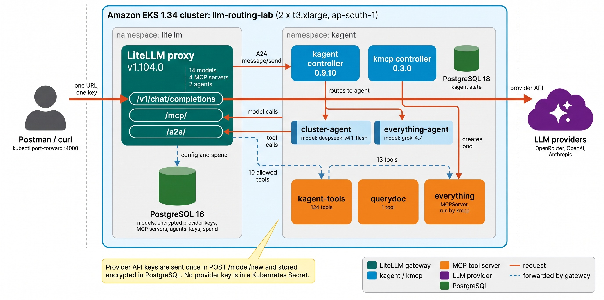

*The whole system. LiteLLM sits between the client, the two agents, the MCP tool servers and the providers; every arrow in or out of the agents passes through it.*

## The building blocks

### LiteLLM

LiteLLM is an open-source Python library and proxy server from BerriAI. It started as a way to call 100+ LLM providers (OpenAI, Anthropic, Google Gemini, Azure, AWS Bedrock, Mistral, Cohere, Ollama and more) through one consistent, OpenAI-style interface. You write your code once, and LiteLLM translates each request into the format the target provider expects.

It has since grown beyond models. The proxy now acts as a single gateway for three layers of an AI system: **models**, **tools** (MCP servers) and **agents** (A2A).

**The problem it solves.** Every LLM provider has its own SDK, request format, response shape, error types and authentication. As soon as a team uses more than one provider, or starts connecting agents and tools, that fragmentation becomes hard to manage. LiteLLM puts one layer in front of all of it.

**Layer 1: models.** As a proxy server it gives a team:

- **Central key management:** developers get virtual keys; real provider keys stay in the gateway.
- **Cost tracking and budgets** per key, user or team.
- **Rate limits** so one application cannot exhaust a shared quota.
- **Fallbacks, retries and load balancing** across providers and deployments of the same model.
- **OpenAI compatibility:** anything that speaks the OpenAI API can use every model behind the proxy.

**Layer 2: tools.** MCP (Model Context Protocol) is the protocol agents use to discover and call tools. MCP servers are registered on LiteLLM once, and clients connect to LiteLLM instead of to each server.

- **One endpoint:** an MCP client points at a single URL, `/mcp/`.
- **Per-key access control** decides which keys can reach which servers.
- **Tool filtering:** a registration can list `allowed_tools`, and the gateway offers only those.
- **Centralized credentials:** upstream secrets for MCP servers live in the gateway.

**Layer 3: agents.** A2A (Agent-to-Agent) is a JSON-RPC protocol for calling an agent: a client sends `message/send` and gets back a task with a state and artifacts. An agent publishes an *agent card*, a JSON document with its name, URL and skills. Agents are registered on LiteLLM by their card and invoked at `/a2a/<agent>`.

**How it works.** The proxy is a FastAPI application backed by PostgreSQL. Models, MCP servers, agents and keys are rows in that database. Each can be created at runtime with a REST call (`POST /model/new`, `POST /v1/mcp/server`, `POST /v1/agents`, `POST /key/generate`). A provider API key sent in `POST /model/new` is encrypted with a salt key (`LITELLM_SALT_KEY`) before it is stored.

**When you don't need it.** If you use a single provider and have no agents or MCP servers to govern, the provider's own SDK is simpler and usually gets new features first. LiteLLM is another service to run, and some governance features (SSO, audit logs, advanced team management) require the enterprise license.

In short: LiteLLM is one place where models, tools and agents are registered, authenticated, limited and tracked.

Sources: [LiteLLM documentation](https://docs.litellm.ai), [source](https://github.com/BerriAI/litellm), [MCP specification](https://modelcontextprotocol.io), [A2A protocol](https://a2a-protocol.org).

### kagent

kagent is a Kubernetes-native framework that brings agent, tool and model configuration into Kubernetes through custom resources. It includes a controller, a UI and a CLI. Solo.io open sourced kagent in March 2025 and donated it to the CNCF.

**The problem it solves.** Without it, agents tend to run as ad-hoc scripts with no consistent deployment, access control or visibility. kagent gives agents the same operating model as the rest of a platform: declarative YAML, namespaces, RBAC, GitOps and review.

**How it works**, in version 0.9.10:

- **`ModelConfig`** names a provider and a model, and points at a Secret with the API key.
- **`RemoteMCPServer`** is the URL of an MCP server. The controller connects to it and writes the tools it finds into `status.discoveredTools`.
- **`Agent`** holds a system prompt, a `ModelConfig` reference and a list of tools taken from MCP servers. The controller turns each `Agent` into a Deployment and a Service.
- **A2A.** The controller serves every agent at `/api/a2a/<namespace>/<name>/`, with its agent card under `.well-known/agent-card.json`.

**What a `RemoteMCPServer` is.** It is a pointer, not a workload. It tells kagent "an MCP server already exists at this URL; connect to it". It creates no pods. Its fields are the URL, the protocol (`STREAMABLE_HTTP` or `SSE`), and optional headers whose values are read from a Secret. The controller connects, lists the server's tools, and records them in the resource's status. "Remote" means kagent did not deploy the server; it can still be inside the cluster.

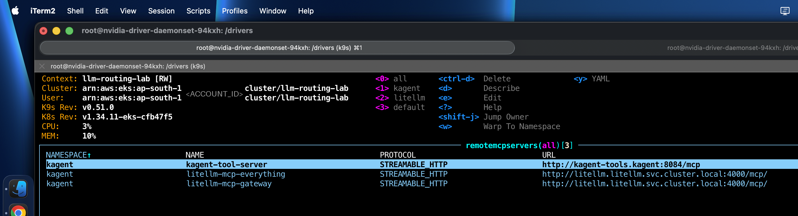

*The three `RemoteMCPServer` resources of this build in k9s. Each row is only a protocol and a URL. Look at the last two: both point at LiteLLM.*

One `RemoteMCPServer` usually offers many tools, and an agent picks the ones it needs by name:

```yaml
tools:
  - type: McpServer
    mcpServer:
      apiGroup: kagent.dev
      kind: RemoteMCPServer
      name: litellm-mcp-gateway
      toolNames:
        - kagent_tools-k8s_get_resources
        - kagent_tools-k8s_get_events
```

Different agents are made by giving each a different tool source, a different `toolNames` list and a different model.

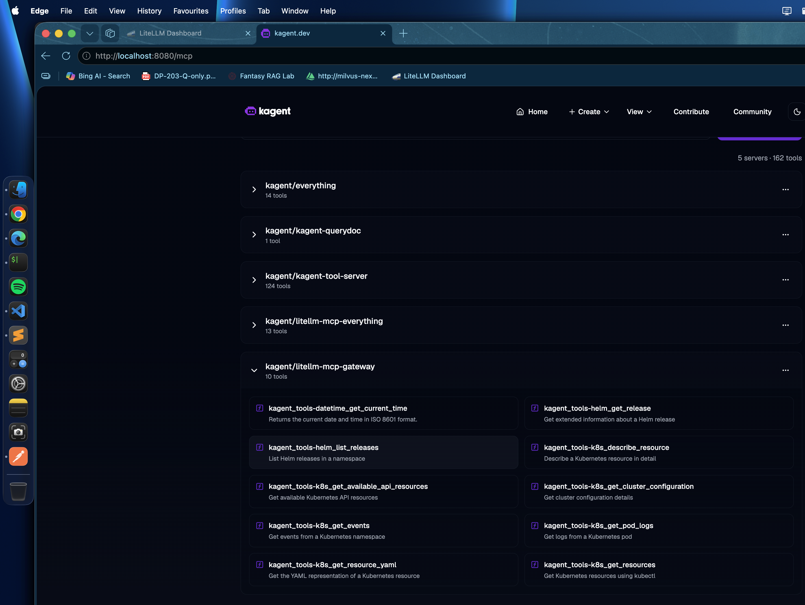

*One `RemoteMCPServer` expanded in the kagent UI: the 10 tools kagent discovered on it. An agent chooses from this list.*

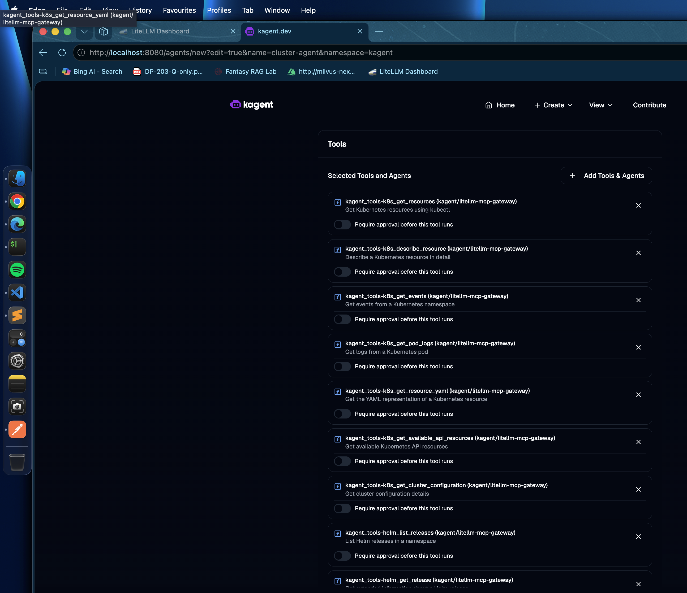

*The tools selected for `cluster-agent`. Each line names the tool and, in brackets, the `RemoteMCPServer` it comes from. Each tool also has a "Require approval" switch, which pauses the agent for a human decision before that tool runs.*

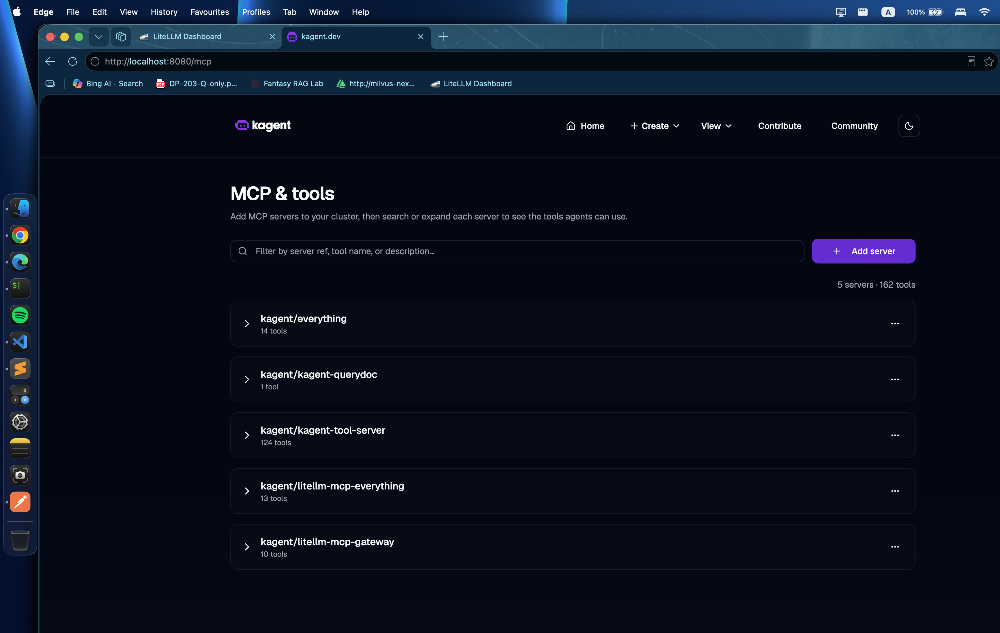

*Every tool source kagent knows in this build, with the tools it discovered on each. Look at `kagent-tool-server` (124 tools) and the two `litellm-mcp-*` entries (13 and 10): the same gateway URL, reached with two different keys.*

kagent's chart also installs ready-made MCP servers. The main one, `kagent-tools`, offered 124 tools in this build: 22 for Kubernetes (`k8s_get_resources`, `k8s_get_pod_logs`, `k8s_delete_resource`, ...), plus Helm, Istio, Cilium, Argo Rollouts, Kubescape and Prometheus tools, and a `shell` tool.

**Downsides.** It needs a Kubernetes cluster and a PostgreSQL database, which is a lot for a single chatbot or a prototype. It is pre-1.0. The 1.0 alphas replace the `Agent` resource with a different model, which is covered below.

In short: kagent makes an agent a Kubernetes resource and exposes it over A2A.

Sources: [kagent.dev](https://kagent.dev), [source](https://github.com/kagent-dev/kagent).

### kmcp

kmcp is a controller and CLI for building and running MCP servers on Kubernetes. It is part of the kagent project, and kagent's chart installs it.

**The problem it solves.** Many MCP servers are packages meant to be started by a desktop client and spoken to over stdin and stdout. Nothing in a cluster can call that. Each team otherwise invents its own way to containerize and expose them.

**How it works.** You create an `MCPServer` resource with a command, arguments and a transport type. The controller creates a Deployment, a Service, a ConfigMap and a ServiceAccount. For a stdio server it does the following:

1. An init container copies the `agentgateway` binary into a shared volume.
2. The main container runs `agentgateway`, which starts your command as a child process.
3. `agentgateway` serves that process's stdio as MCP over streamable HTTP on the Service port, at `/mcp`.

If the command is `npx` or `uvx` and you give no image, the controller uses a default Node or uv image. The CLI adds project scaffolding (`kmcp init`), image builds (`kmcp build`) and deployment (`kmcp deploy`).

An existing Service can also be offered to kagent as a tool source without kmcp, by giving it the label `kagent.dev/mcp-service: "true"` and a port with `appProtocol: mcp`. kagent's own `querydoc` server is exposed that way.

**Downsides.** kmcp ships no MCP servers of its own; it is machinery. It is at version 0.3.0 in this build.

In short: kmcp runs the tools, and kagent runs the agents that use them.

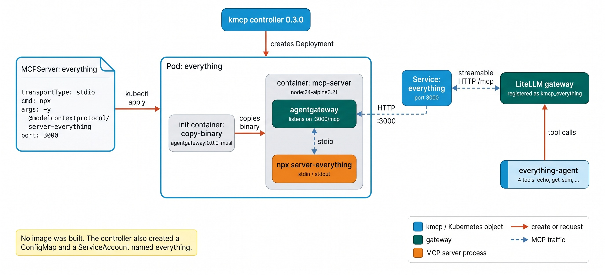

*What kmcp creates from one `MCPServer` resource. Look at the two processes inside the `mcp-server` container.*

Sources: [source](https://github.com/kagent-dev/kmcp), [agentgateway](https://agentgateway.dev).

## Why build it this way

- **The agent's model comes from the gateway, not from a provider.** kagent holds a LiteLLM virtual key with a budget. It never sees a provider key.
- **The agent's tools come from the gateway, not from the tool server.** kagent is pointed at LiteLLM's `/mcp/` endpoint. What the agent can call is decided at the gateway.
- **The agent is invoked at the gateway.** Callers use a LiteLLM key and one URL.
- **Everything in the gateway is created by REST.** No model, MCP server or agent is in a config file, so each registration is one visible HTTP call.
- **The source code is the reference.** Chart values, CRD fields and request bodies were read from local checkouts of the three projects at pinned versions, not from documentation.
- **One virtual key per agent.** Each agent's key is limited to the models and MCP servers that agent needs, and its spend is recorded separately.
- **Provider keys are never in a Kubernetes Secret.** They are sent once in `POST /model/new` and stored encrypted in PostgreSQL.

## Setup

The full commands are in the [setup guide](setup-guide.md).

1. **Cluster.** EKS 1.34, two `t3.xlarge` nodes in private subnets, one NAT gateway. The EBS CSI driver and a default `gp3` StorageClass are added because both PostgreSQL instances need a volume, and EKS's `gp2` class is not marked default.
2. **LiteLLM.** Installed from the chart in the source tree with its bundled PostgreSQL. The image tag is pinned to `v1.104.0`; the chart's default is `v1.85.1`. `LITELLM_SALT_KEY` is supplied from a Secret because the chart has no value for it. The config file has an empty model list.
3. **A virtual key for kagent.** `POST /key/generate` with a 10 USD budget. Stored in a Secret in the `kagent` namespace.
4. **kagent and kmcp.** kagent 0.9.10 from its published charts, which include kmcp 0.3.0. The default `ModelConfig` is `provider: OpenAI` with `baseUrl` set to the LiteLLM Service. The ten bundled agents are switched off.
5. **An MCP server through kmcp.** One `MCPServer` resource running the public `@modelcontextprotocol/server-everything` package with `npx`.
6. **Register four MCP servers in LiteLLM.** `kagent_tools` (with `allowed_tools`), `kagent_querydoc`, `kagent_agents` and `kmcp_everything`.
7. **Point kagent at the gateway for tools.** A `RemoteMCPServer` whose URL is LiteLLM's `/mcp/` and whose `x-litellm-api-key` header comes from the Secret.
8. **Create the agent.** An `Agent` with a read-only system prompt and ten tools from the gateway.
9. **Register the agent in LiteLLM.** `POST /v1/agents` with the fields from the card kagent serves.
10. **Register models in LiteLLM.** `POST /model/new` with the provider key in the body. 14 deployments were added by hand through the Postman collection.
11. **Add models to kagent.** One `ModelConfig` per model. Then one line on the `Agent` selects it.
12. **A second agent.** `everything-agent` uses a different model, the kmcp-run tool server, and its own key.

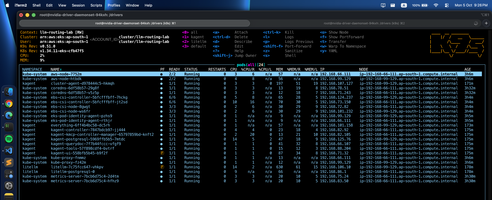

*The cluster after step 8, in k9s: LiteLLM and its PostgreSQL, the kagent and kmcp controllers, the tool servers and the first agent, all `Running`.*

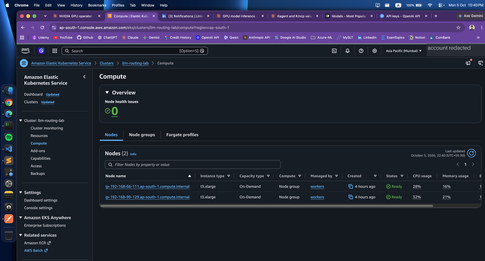

*The two `t3.xlarge` nodes in the AWS console with everything running: 28% and 32% CPU, 16% and 21% memory.*

### Registering in the gateway with REST calls

Everything LiteLLM governs is created through its management API. The three calls have the same pattern: a `POST` with the master key and a JSON body.

- **A model:** `POST /model/new` with `model_name`, and `litellm_params` holding the provider path and the provider API key.
- **An MCP server:** `POST /v1/mcp/server` with `server_name`, `transport: "http"`, the in-cluster `url`, and optionally `allowed_tools`.
- **An agent:** `POST /v1/agents` with `agent_name` and the agent card (name, description, URL, skills) that kagent serves for the agent.

Two rules come from the source and are easy to miss. `transport` defaults to `sse`, so `http` must be set for a streamable-HTTP server. A server name cannot contain a hyphen, because LiteLLM names tools `<alias>-<tool>`.

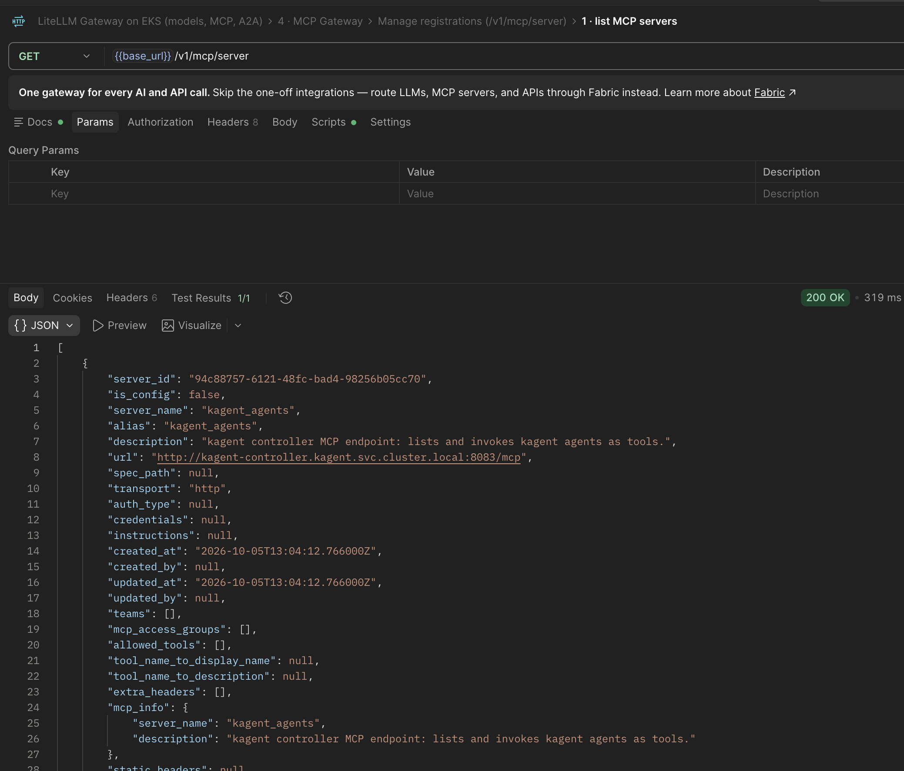

*A registered MCP server as LiteLLM returns it. Look at `is_config: false`: the record is in the database, created by the API.*

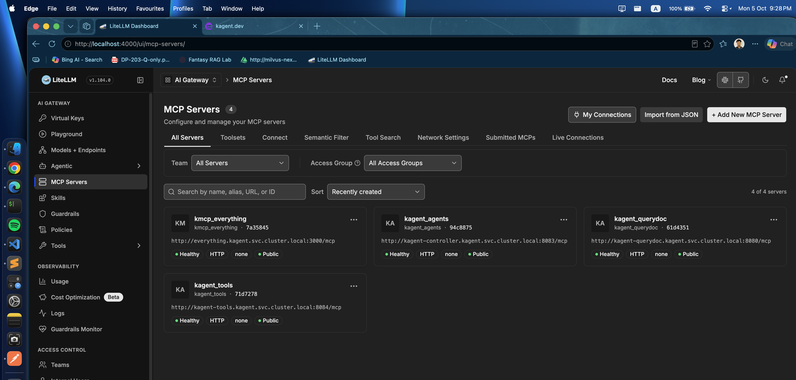

*The four in-cluster MCP servers in the LiteLLM UI, all healthy.*

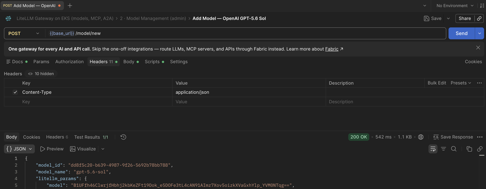

*The response to `POST /model/new`. Look at line 5: the provider path comes back as ciphertext, because LiteLLM returns the values as stored, encrypted with the salt key.*

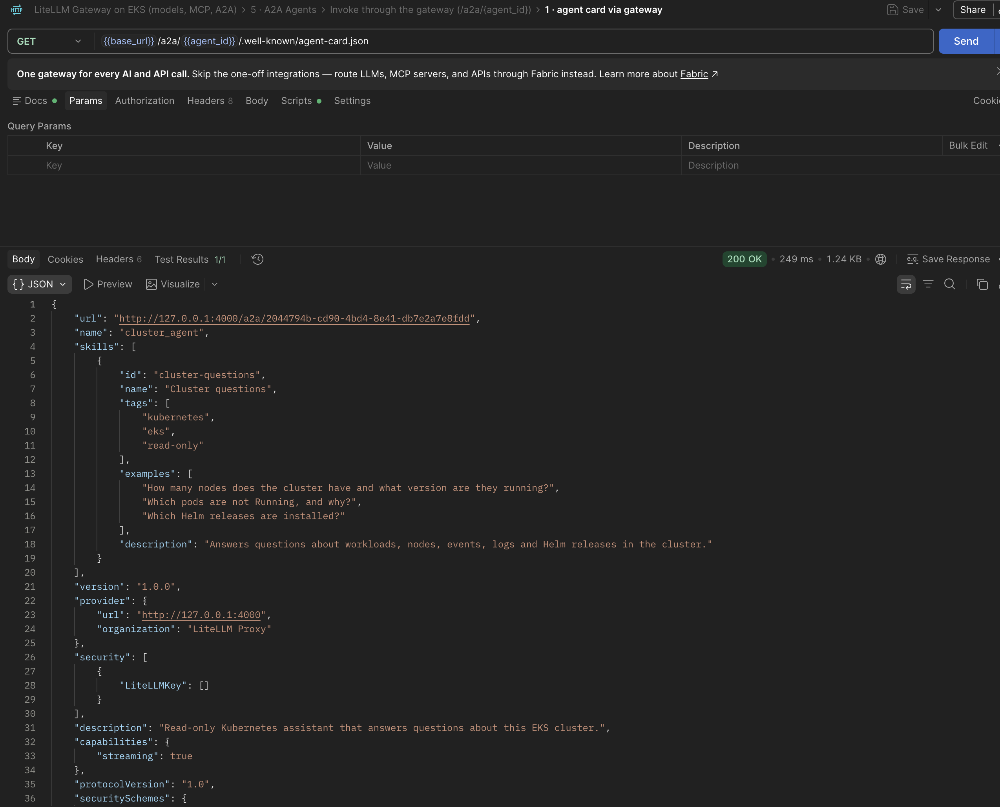

*The agent's card as the gateway serves it after registration. Look at `url`: callers are sent to LiteLLM, not to kagent.*

### Models in kagent, when the gateway owns the providers

A kagent `ModelConfig` normally names a provider and holds that provider's key. Behind a gateway it becomes the same five lines every time:

```yaml
spec:
  provider: OpenAI                 # always: LiteLLM speaks the OpenAI API
  model: deepseek-v4.1-flash       # the LiteLLM model_name
  apiKeySecret: kagent-litellm     # a LiteLLM virtual key
  apiKeySecretKey: LITELLM_API_KEY
  openAI:
    baseUrl: http://litellm.litellm.svc.cluster.local:4000/v1
```

`provider` stays `OpenAI` even when the real model is from DeepSeek or xAI through OpenRouter, because kagent only ever talks to LiteLLM. `model` is the name the gateway gave the model (`deepseek-v4.1-flash`), not the provider path (`openrouter/deepseek/deepseek-v4.1-flash`). Changing an agent's model is one line, `modelConfig: grok-4-7`, and the controller replaces the pod.

The two agents in this build:

- **`cluster-agent`**: `deepseek-v4.1-flash`, 10 read-only Kubernetes and Helm tools from `kagent_tools`, key `kagent` (10 USD budget, MCP server `kagent_tools` only).
- **`everything-agent`**: `grok-4.7`, 4 tools from `kmcp_everything`, key `kagent-everything-agent` (5 USD budget, model `grok-4.7` only, MCP server `kmcp_everything` only).

Both agents point at the same gateway URL for tools. kagent discovered 10 tools there with the first key and 13 with the second.

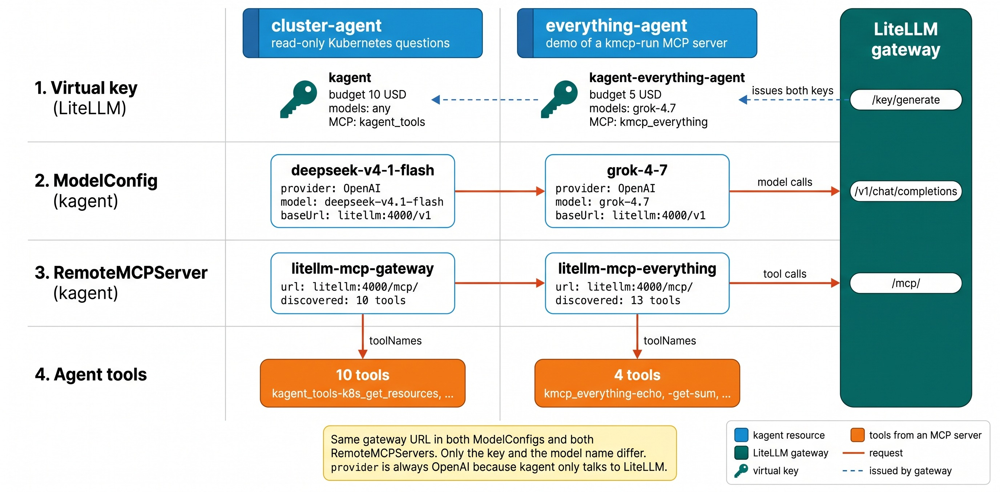

*The two agents, part by part. Look at rows 2 and 3: the gateway URL is the same in both columns, and only the key and the model name change.*

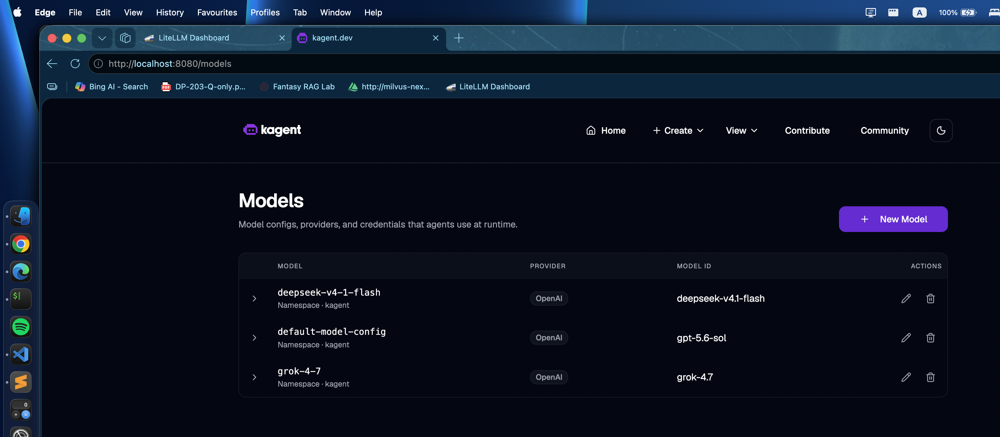

*The model configs in the kagent UI. Every provider reads `OpenAI`; the Model ID is the LiteLLM model name.*

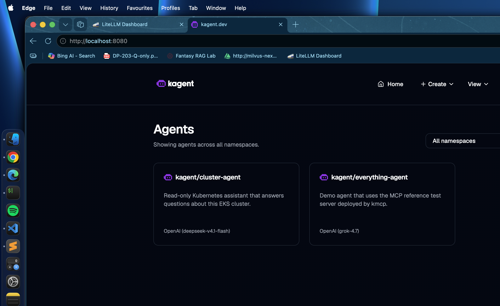

*The two agents, each on its own model.*

### The most instructive problem: "latest" was the wrong version

The plan was to use the newest code of all three projects. The kagent checkout was at `v1.0.0-alpha4`. Reading its Helm chart before installing showed five CRDs: `Harness`, `AgentTemplate`, `ModelConfig`, `ModelProviderConfig` and `RemoteMCPServer`. There was no `Agent`.

In that version an agent is a `Harness` paired with an `AgentTemplate`, and a running one is an `AgentInstance` stored in PostgreSQL. The controller needs a separate runtime called Substrate before any agent starts, with a gVisor worker pool, certificate and JWT pools, and an object store for snapshots. The repository's own setup notes say that a plain install "does not work" without those steps, and that "the controller crash-loops while its pod reports `1/1 Ready`". The top-level README of the same checkout still described the old `Agent` resource. `v1.0.0-alpha5`, tagged two days later, renames the CRD group from `kagent.dev` to `api.kagent.dev`.

The fix was to build on `v0.9.10`, the latest non-prerelease tag, and to pin kmcp to `v0.3.0`, the version kagent 0.9.10 depends on in its `go.mod`.

The general lesson: check which resources a chart installs before designing around a project, and treat the newest tag and the newest stable tag as different things. Here the README would not have revealed the difference; the CRD directory did.

## The key concept: every hop goes through the gateway

One question to the agent crosses the gateway three times.

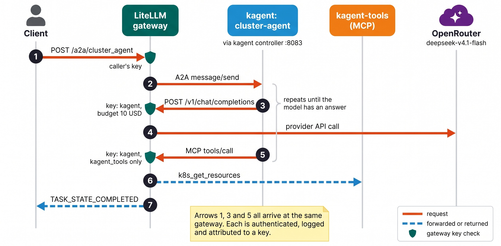

*The path of one question. Look at arrows 1, 3 and 5: all three arrive at LiteLLM and each is checked against a key.*

1. **Client to agent.** The client sends A2A `message/send` to `LiteLLM/a2a/cluster_agent`. LiteLLM checks the caller's key and forwards to the kagent controller at `/api/a2a/kagent/cluster-agent/`.
2. **Agent to model.** The agent pod calls `LiteLLM/v1/chat/completions` with the kagent virtual key. LiteLLM checks the key and its budget, then calls the provider with the stored provider key.
3. **Agent to tool.** When the model asks for a tool, the agent sends MCP `tools/call` to `LiteLLM/mcp/` with the same key. LiteLLM checks that the key may use that server and that the tool is allowed, then forwards to `kagent-tools`.

Two filters sit on the tool path, and they are separate settings:

- **`allowed_tools` on the server registration** reduces `kagent-tools` from 124 tools to 10 for everyone.
- **`object_permission.mcp_servers` on the key** reduces the kagent key from four servers to one.

The arithmetic: the gateway aggregates 10 + 1 + 2 + 13 = 26 tools from four servers. The master key sees 26. The kagent key sees 10.

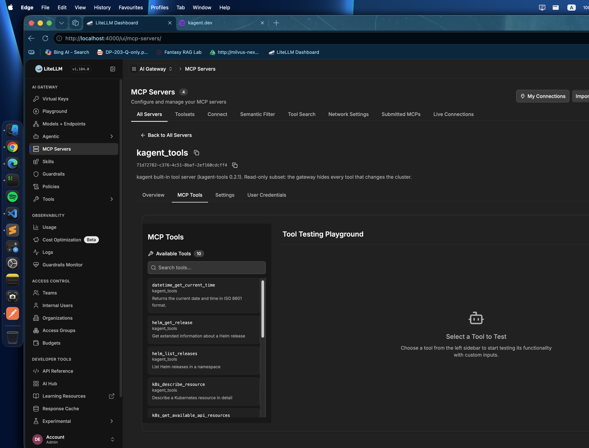

*The `kagent_tools` registration in the LiteLLM UI: 10 available tools out of the 124 the server offers.*

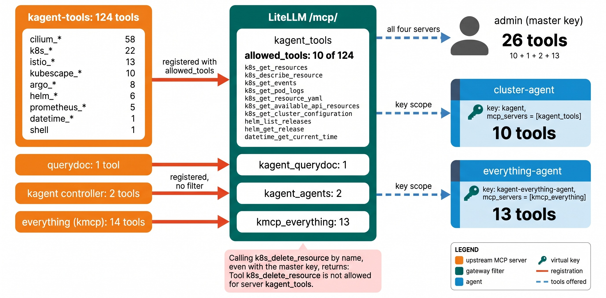

*Where 124 tools become 10. Look at the two separate filters: one on the registration, one on the key.*

A detail that matters for naming: LiteLLM exposes each tool as `<alias>-<tool>`, for example `kagent_tools-k8s_get_resources`. A server name therefore cannot contain a hyphen. The kagent `Agent` lists its tools by these prefixed names.

## Method

**What was checked.** For each hop, a request was sent and the response saved: the MCP handshake and `tools/list` at the gateway, a `tools/call` for an allowed tool, a `tools/call` for a hidden tool, `tools/list` with the scoped key, the tools kagent discovered, the agent card from kagent and from the gateway, and an A2A `message/send`.

**Verified, not configured.** The tool counts come from what the servers returned (`tools/list`, and kagent's `status.discoveredTools`), not from the `allowed_tools` list that was submitted.

**Workload.** Seven questions to `cluster-agent` and three to `everything-agent`, each sent once as A2A `message/send` to the gateway. The seventh question asks the agent to delete a pod.

**Checking the answers.** Each `cluster-agent` answer was compared with `kubectl` and `helm` output taken right after the run. A completed task is not counted as a correct answer.

**Spend.** Read from LiteLLM's spend logs per virtual key after the runs.

## Results

Measured on 2026-10-05 on the cluster described above. Raw responses are in `results/raw/`.

- **Tools offered by `kagent-tools` upstream:** 124.
- **Tools the gateway offers for `kagent_tools`:** 10.
- **Tools at the aggregated endpoint with the master key:** 26, from four servers.
- **Tools at the aggregated endpoint with the kagent key:** 10.
- **Tools kagent discovered through the gateway:** 10.
- **`k8s_get_resources` for nodes, through the gateway:** returned both nodes, `v1.34.11-eks-3b4a6ca`.
- **`k8s_delete_resource`, called by name with the master key:** `Error: Tool k8s_delete_resource is not allowed for server kagent_tools. Contact proxy admin to allow this tool.`
- **`echo` on the kmcp-managed server, through the gateway:** `Echo: hello from kmcp via LiteLLM`.
- **A2A `message/send` to the agent, before a model was registered:** a task in state `TASK_STATE_FAILED`, carrying LiteLLM's HTTP 400 `Invalid model name passed in model=gpt-5.6-sol`.

Agents, through the gateway:

- **`cluster-agent`:** 7 of 7 tasks completed, in 3 s to 8 s each (whole seconds, one run).
- **Fully correct answers:** 5 of 7.
- **Incomplete:** 1. It confirmed the instance type `t3.xlarge` for one of the two nodes and said it had not checked the other.
- **Wrong:** 1. It reported 15 pods in `kube-system` and 26 in total. The cluster had 14 and 25.
- **Delete request:** refused. "I can't delete that pod — my tools are read-only."
- **`everything-agent`:** 3 of 3 tasks completed. "The sum of 1234.5 and 8765.5 is 10000" and "Echo: hello from kmcp" came from tool calls. Asked about cluster nodes, it answered that no available tool can report that.
- **The `everything-agent` key asking for `deepseek-v4.1-flash`:** HTTP 403, "not available for this API key".

Spend per key, from LiteLLM's logs:

- **`kagent`:** 24 model calls to `deepseek-v4.1-flash`, 69,758 tokens, 0.01139 USD. 18 MCP tool calls. 234 MCP `list_tools` calls.
- **`kagent-everything-agent`:** 5 model calls to `grok-4.7`, 10,198 tokens, 0.01078 USD. 2 MCP tool calls. 5 `list_tools` calls.

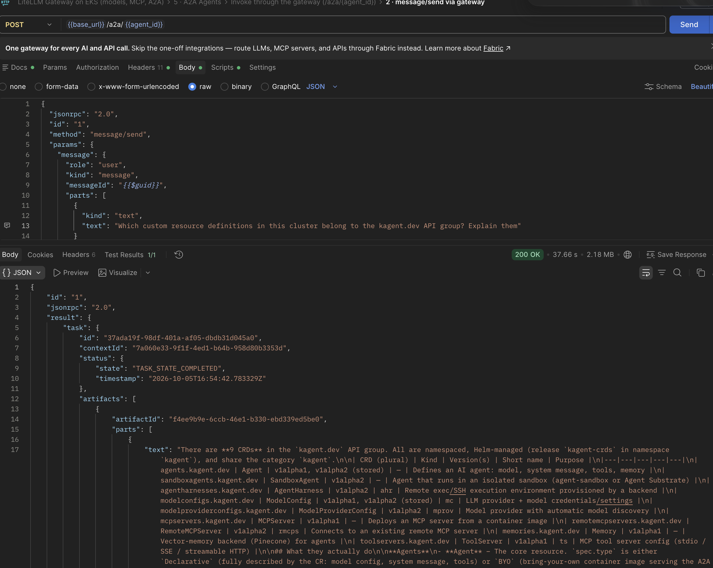

*An A2A `message/send` to the cluster agent through the gateway, from Postman. Look at `state: TASK_STATE_COMPLETED` and the answer in `artifacts`.*

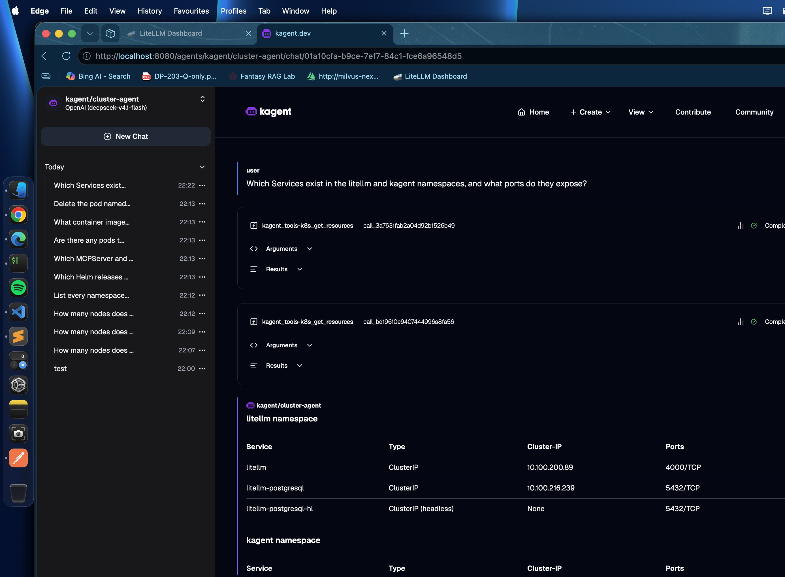

*The same agent in the kagent UI. Look at the tool-call cards: the tool name carries the `kagent_tools-` prefix, so the call went through LiteLLM.*

## Findings

**The gateway filter is enforced on the call, not only on the listing.** `k8s_delete_resource` does not appear in `tools/list`, and calling it by its full name is refused even with the master key. A client that knows a tool name cannot go around the filter.

**An agent can be restricted without touching the agent.** kagent found 10 tools at the gateway. Its own tool server offers 124, including `shell` and `k8s_execute_command`. The agent's definition did not have to list what it must not do; the gateway never offered those tools.

**kagent needed nothing LiteLLM-specific.** The model path is a `ModelConfig` with `provider: OpenAI` and a `baseUrl`. The tool path is a `RemoteMCPServer` with one header. The failed first invocation confirms the model path: the 400 came from LiteLLM.

In short: one registration field and one key field decide what an agent can do, and both live outside the agent.

**A completed task is not a correct answer.** All seven tasks ended in `TASK_STATE_COMPLETED`. One answer was wrong: 15 pods in `kube-system` where there were 14, and the agent's own answer two questions later said 14. The tool returned the right list; the model miscounted it. A gateway decides what an agent may call. It does not check what the model does with the result.

**Model calls and tool calls end up in one log, per key.** For the `kagent` key the same log holds 24 model calls and 18 tool calls. Refused calls are there too, with zero spend: the 403 for the wrong model, and the model calls that failed before a model was registered.

**Per-agent spend did not show up on the agent records.** `GET /v1/agents` reported `spend: 0.0` for both agents after the runs. The cost was on the keys. Giving each agent its own key is what made per-agent cost visible in this build.

**Tool discovery is chatty.** 234 `list_tools` calls against 18 real tool calls in about four hours for one key. kagent re-lists each tool source repeatedly: in LiteLLM's log, consecutive `list_tools` rows for one key are 63 to 64 seconds apart. At this size it cost nothing.

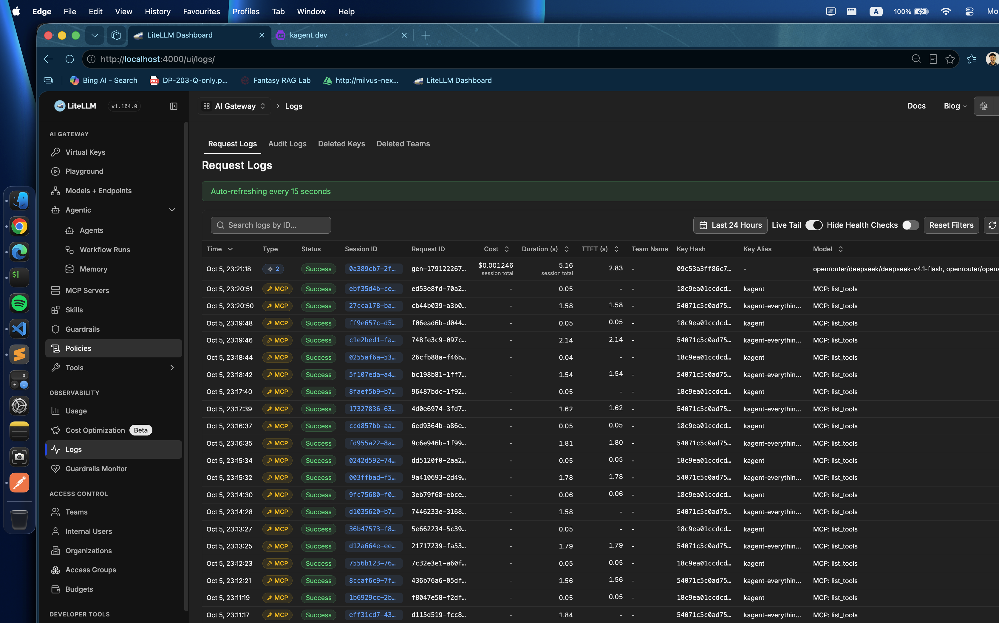

*LiteLLM's request log. Look at the Key Alias column: the two agents' keys alternate, each listing tools about once a minute. The top row is a model call with its cost, in the same log.*


In short: the gateway gave one place to limit and observe both agents, and the logs showed things the agents' own status did not.

**kmcp ships no MCP servers.** The servers that come with a kagent install belong to kagent's chart. kmcp's chart installs a controller. Its value showed in step 5: one resource with `cmd: npx` and no image produced a running, HTTP-reachable MCP server.

**A first reconcile can fail and stay failed.** Right after install, kagent's `RemoteMCPServer` for its own tool server showed `ACCEPTED False` with `connection refused`, because the controller tried before the tool pod was listening. About 40 seconds later it was still `False`. An annotation on the resource triggered a new reconcile and it became `True`. How long it would have taken on its own was not measured.

**Three defaults would have failed quietly.** The LiteLLM chart's default image is 19 minor versions behind its source. The chart never sets the salt key, so the master key would have encrypted stored provider keys. EKS's `gp2` StorageClass is not default, so both database volume claims would have stayed `Pending`.

In short: read the chart, not the README, before the first install.

## Limitations

- **One cluster, one run, ten questions.** Each question was asked once. 5 of 7 is what happened, not an accuracy figure. Durations are whole seconds from single requests.
- **One answer detail was not checked.** The agent mentioned an earlier liveness-probe warning on the LiteLLM pod.
- **Only two of the 14 registered models were used by agents.** Nothing here compares models.
- **Not a production setup.** One LiteLLM replica, single-node databases without backup, no ingress, no TLS inside the cluster, kagent's controller in its default `unsecure` auth mode.
- **The gateway is not the only path.** Any pod in the cluster can call the kagent controller's A2A endpoint or the `kagent-tools` Service directly. Making the gateway mandatory needs NetworkPolicies, which were not applied.
- **The tool server's own Kubernetes permissions were left at kagent's default.** The gateway limits which tools are called, not what the tool server's service account may do.
- **Pre-1.0 software.** kagent 0.9.10 and kmcp 0.3.0. kagent's 1.0 alphas replace the resource model used here.
- **Not compared.** No other gateway and no other agent runtime was tried, and nothing here measures latency or throughput.

## Reproduce it

Repository: https://github.com/tharindu-sankalpa/eks-llm-routing-stack. Start at `docs/setup-guide.md`. You need an AWS account with 8 spare on-demand vCPUs in the region and one LLM provider API key. The EKS control plane, two `t3.xlarge` nodes, one NAT gateway and 9 GiB of volumes are billed while they exist. The hourly total was not calculated for this write-up; price it for your region with the AWS Pricing Calculator before you start. Teardown is the last section of the guide.
