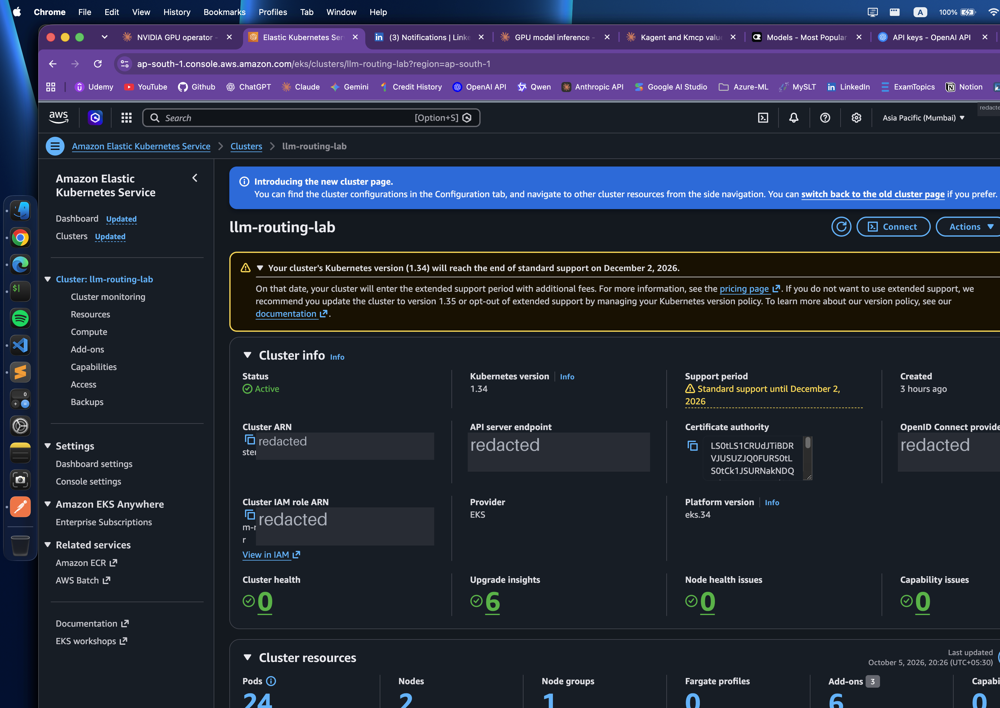
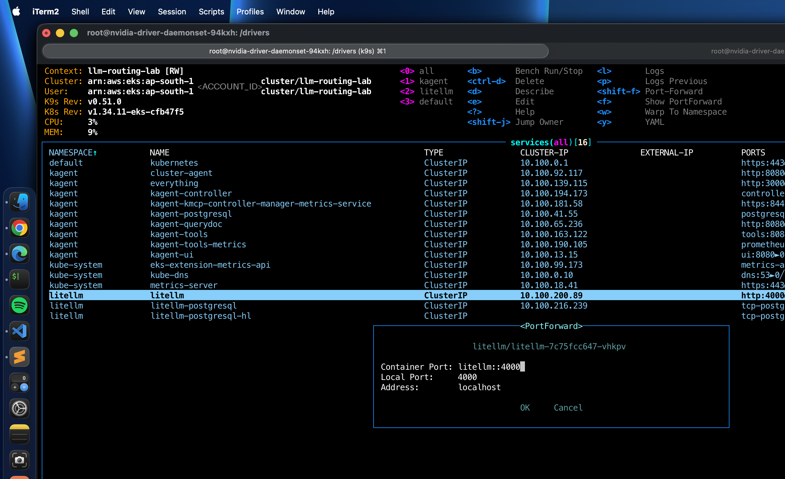
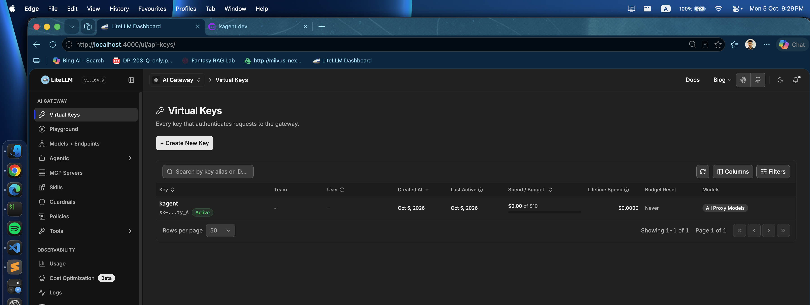
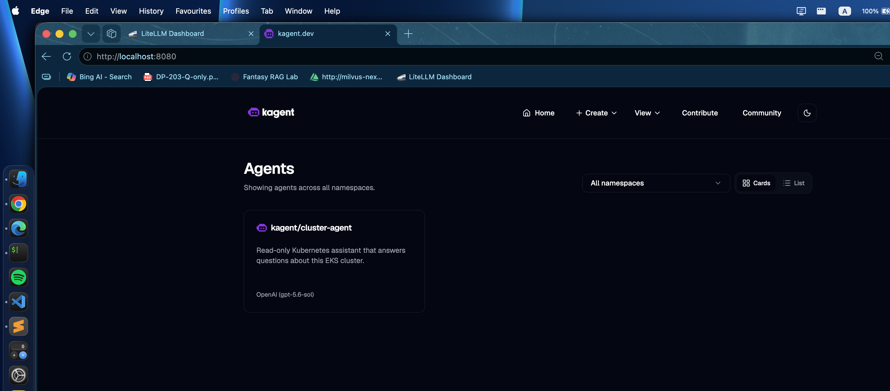
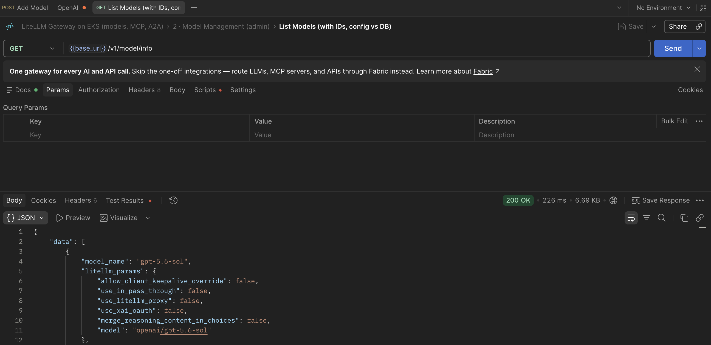
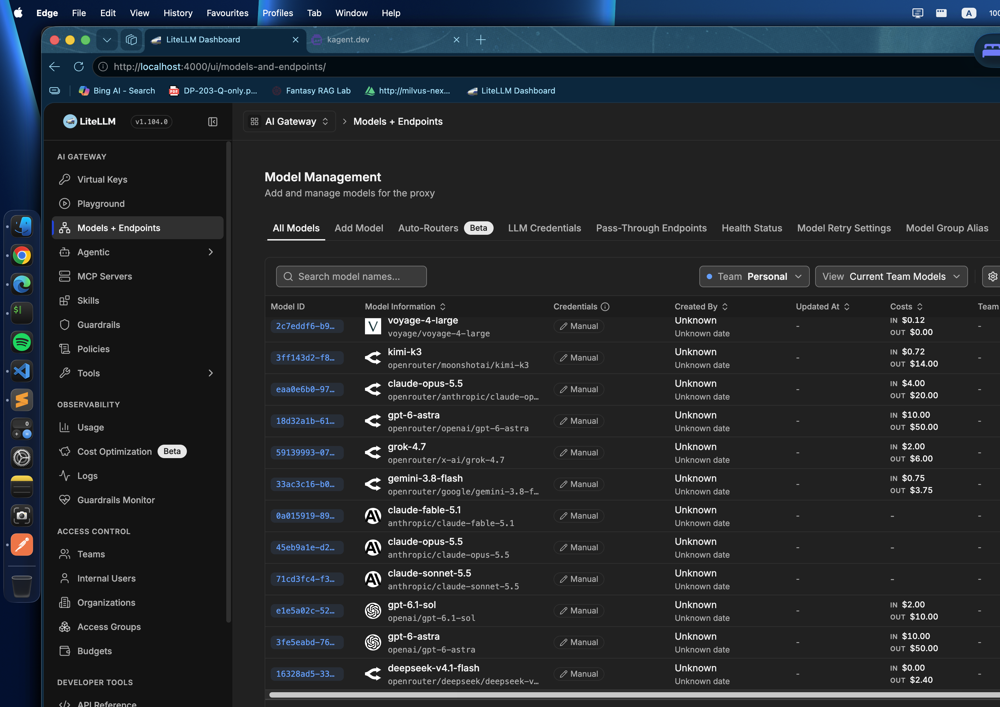
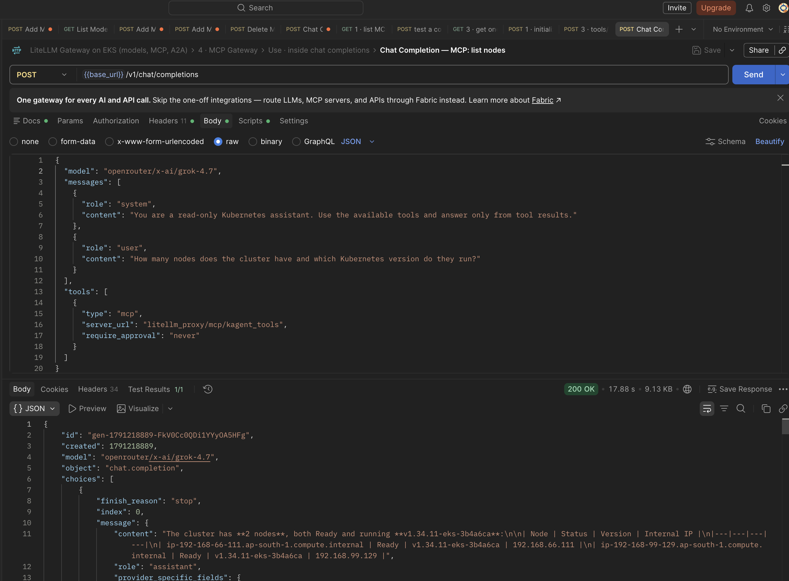

# Setup guide: LiteLLM, kagent and kmcp on Amazon EKS

This guide records every command used to build the stack, in the order it was run on 2026-10-05. Each step says what it does, why, the command, and the output that shows it worked. Errors are recorded where they happened, with the message, the cause and the fix.

**Status of this record:** steps 0 to 20 were run and verified, except where a line is marked `TODO`. Teardown has not been run.

**Manual and automated.** Infrastructure is created with `eksctl` and `helm` from files in `infra/`. Everything inside LiteLLM (models, MCP servers, agents, keys) is done through its REST API, shown here as `curl` and also available as a Postman collection. Nothing is registered through a config file, so each registration is visible as one HTTP call.

**Cost and teardown.** The EKS control plane, the two `t3.xlarge` nodes, the NAT gateway and two EBS volumes are billed while they exist. [Teardown](#teardown) is at the end.


*The whole system as built by this guide. Steps 3 to 8 create the boxes; steps 9 to 18 create the arrows.*

## Conventions

- Lines starting with `$` are commands. Lines without it are output.
- Output is trimmed to the lines that prove the step. Names, IPs, IDs and ages will differ for you.
- `<ACCOUNT_ID>` and similar are placeholders for values removed from the output.
- Keys are never shown. `sk-…` stands for a real key.

## 0. Variables

What this does: defines every value that is reused, once.

Why: the cluster gets its own kubeconfig file, so no command in this guide can reach another cluster by accident.

```bash
$ export AWS_REGION=ap-south-1
$ export CLUSTER=llm-routing-lab
$ export KUBECONFIG=$PWD/.kube/config        # gitignored, used only for this cluster
$ export LITELLM=http://127.0.0.1:4000       # LiteLLM through a port-forward
$ cp .env.example .env                       # then fill in the four values
$ set -a && . ./.env && set +a
```

`.env` holds four internal secrets: `LITELLM_MASTER_KEY`, `LITELLM_SALT_KEY`, `LITELLM_POSTGRES_PASSWORD`, `LITELLM_POSTGRES_ADMIN_PASSWORD`. No provider API key is stored in `.env` or in any Kubernetes Secret anywhere in this guide.

## 1. Source checkouts

What this does: clones the three projects and pins the versions that are installed.

Why: the charts, CRD fields and REST request bodies in this guide were read from these checkouts, not from documentation. `repos/` is gitignored.

| Project | Version used | Commit | Why this version |
|---|---|---|---|
| LiteLLM | 1.104.0 (`pyproject.toml`) | `74cad08997` | Head of `main` on 2026-09-28. Image `ghcr.io/berriai/litellm:v1.104.0` exists. |
| kagent | v0.9.10 | `78ab524a` | Latest non-prerelease tag (2026-06-22). |
| kmcp | v0.3.0 | `1cec647` | The version kagent 0.9.10 bundles (`go/go.mod`: `github.com/kagent-dev/kmcp v0.3.0`). |

```bash
$ git -C repos/kagent checkout v0.9.10
$ git -C repos/kmcp checkout v0.3.0
```

### Why not the newest kagent

The kagent clone was first at `v1.0.0-alpha4`. That version is a different architecture:

- There is no `Agent` CRD. An agent is a `Harness` plus an `AgentTemplate`, and a running one is an `AgentInstance` stored in PostgreSQL.
- The controller needs Substrate (a separate runtime with a gVisor worker pool, CA and JWT pools, and S3 snapshots) before any agent can run.
- `v1.0.0-alpha5`, tagged two days later, renames the CRD group from `kagent.dev` to `api.kagent.dev`.

A guide written against alpha4 would describe a schema that is already superseded. This build uses v0.9.10, where an agent is one `Agent` resource.

## 2. Tooling and pre-flight checks

What this does: records tool versions and checks, read-only, that the region can host the cluster.

```bash
$ aws --version; eksctl version; kubectl version --client; helm version --short; jq --version
$ aws service-quotas get-service-quota --service-code ec2 --quota-code L-1216C47A \
    --region $AWS_REGION --query 'Quota.Value' --output text
32.0
```

`L-1216C47A` is the quota for running on-demand standard instances, in vCPUs. This build uses 8 (2 × `t3.xlarge`).

| Tool | Version |
|---|---|
| aws-cli | 2.37.4 |
| eksctl | 0.230.0-dev |
| kubectl | v1.35.0 |
| helm | v4.2.4 |
| jq | 1.8.2 |

## 3. EKS cluster

What this does: creates a VPC with two availability zones and one NAT gateway, the EKS 1.34 control plane, a managed node group of 2 × `t3.xlarge` in private subnets, and the add-ons.

Why these choices:

- **Private nodes, one NAT gateway.** Nodes have no public IPs. One NAT gateway instead of one per zone is enough for a lab.
- **`t3.xlarge` × 2.** 8 vCPU and 32 GiB in total for LiteLLM, two Postgres instances, the kagent controller and UI, the tool servers and the agent pod.
- **EBS CSI driver.** Both Postgres instances need a PersistentVolumeClaim. See step 4.

The configuration is [infra/eks/cluster.yaml](../infra/eks/cluster.yaml).

```bash
$ eksctl create cluster -f infra/eks/cluster.yaml --kubeconfig $KUBECONFIG
```

**This single command was not the one run for this record.** The control plane already existed (created by `eksctl` earlier the same day, without a node group), so the node group and add-ons were added to it with the three commands below. `cluster.yaml` describes the resulting state. The one-command path is therefore untested as written.

```bash
$ aws eks update-kubeconfig --region $AWS_REGION --name $CLUSTER --kubeconfig $KUBECONFIG --alias $CLUSTER
$ eksctl create nodegroup -f infra/eks/cluster.yaml
2026-10-05 18:18:31 [ℹ]  deploying stack "eksctl-llm-routing-lab-nodegroup-workers"
2026-10-05 18:21:02 [✔]  created 1 managed nodegroup(s) in cluster "llm-routing-lab"

$ eksctl create addon --cluster $CLUSTER --region $AWS_REGION --name eks-pod-identity-agent
2026-10-05 18:21:45 [ℹ]  addon "eks-pod-identity-agent" active

$ eksctl create addon --cluster $CLUSTER --region $AWS_REGION --name aws-ebs-csi-driver \
    --auto-apply-pod-identity-associations
2026-10-05 18:21:48 [ℹ]  deploying stack "eksctl-llm-routing-lab-addon-aws-ebs-csi-driver-podidentityrole-ebs-csi-controller-sa"
2026-10-05 18:22:19 [ℹ]  creating addon: aws-ebs-csi-driver
```

`--auto-apply-pod-identity-associations` makes eksctl create the IAM role the EBS CSI controller needs and bind it to the `ebs-csi-controller-sa` service account through EKS Pod Identity. That is why the Pod Identity agent add-on is installed first.

Verify:

```bash
$ kubectl get nodes
NAME                                 STATUS   ROLES    AGE   VERSION
ip-<IP>.ap-south-1.compute.internal  Ready    <none>   65s   v1.34.11-eks-3b4a6ca
ip-<IP>.ap-south-1.compute.internal  Ready    <none>   64s   v1.34.11-eks-3b4a6ca

$ aws eks list-addons --region $AWS_REGION --cluster-name $CLUSTER --output text
ADDONS  aws-ebs-csi-driver
ADDONS  coredns
ADDONS  eks-pod-identity-agent
ADDONS  kube-proxy
ADDONS  metrics-server
ADDONS  vpc-cni
```

Installed add-on versions: `aws-ebs-csi-driver` v1.66.0-eksbuild.1, `eks-pod-identity-agent` v1.3.10-eksbuild.3.



*The cluster in the AWS console: `Active`, Kubernetes 1.34, platform `eks.34`, 2 nodes in 1 node group, 6 add-ons. The account ID, API server endpoint and OIDC URL are covered.*


*The Compute tab: two `t3.xlarge` On-Demand nodes in the `workers` node group, both `Ready`. Captured near the end of the build, with every workload running: 28% and 32% CPU, 16% and 21% memory.*


### Errors hit here

**`eksctl create nodegroup` has no `--kubeconfig` flag.**

```
Error: unknown flag: --kubeconfig
```

Cause: `--kubeconfig` belongs to `eksctl create cluster`. `create nodegroup` reaches the cluster through AWS credentials and writes no kubeconfig. Fix: drop the flag.

The failure was first missed because the command was piped into `tail`, and the pipeline's exit status was `tail`'s, which is 0. Fix: `set -o pipefail` before piping a command whose exit status matters.

## 4. Default StorageClass

What this does: creates a `gp3` StorageClass backed by the EBS CSI driver and marks it default.

Why: EKS creates a `gp2` class but does not mark it default. A PersistentVolumeClaim with no `storageClassName` (both Postgres charts create one) would stay `Pending`.

```bash
$ kubectl get sc
NAME   PROVISIONER             RECLAIMPOLICY   VOLUMEBINDINGMODE      ALLOWVOLUMEEXPANSION
gp2    kubernetes.io/aws-ebs   Delete          WaitForFirstConsumer   false

$ kubectl apply -f infra/eks/storageclass-gp3.yaml
$ kubectl get sc
NAME            PROVISIONER             RECLAIMPOLICY   VOLUMEBINDINGMODE      ALLOWVOLUMEEXPANSION
gp2             kubernetes.io/aws-ebs   Delete          WaitForFirstConsumer   false
gp3 (default)   ebs.csi.aws.com         Delete          WaitForFirstConsumer   true
```

## 5. LiteLLM with its bundled Postgres

What this does: installs the LiteLLM proxy from the chart in the source checkout (`repos/litellm/helm/litellm-helm`, chart version 1.1.3) with the Postgres subchart it vendors (Bitnami `postgresql` 14.3.1, image `bitnamilegacy/postgresql:16.2.0-debian-12-r6`).

Why each setting in [infra/litellm/values.yaml](../infra/litellm/values.yaml):

- **`image.tag: v1.104.0`.** With no tag the chart uses its `appVersion`, `v1.85.1`, which is 19 minor versions behind the source.
- **`masterkeySecretName`.** The master key comes from a Secret created below, not from a generated one.
- **`environmentSecrets: [litellm-env]`.** Supplies `LITELLM_SALT_KEY`. LiteLLM encrypts provider API keys with this key before writing them to Postgres. The chart has no value for it. If it is unset, the master key is used as the salt (`litellm/proxy/common_utils/encrypt_decrypt_utils.py`), and the salt cannot be changed later without losing the stored keys.
- **`STORE_MODEL_IN_DB: "True"`.** `POST /model/new` returns HTTP 500 without it.
- **`model_list: []`.** No model is defined in the config file. The chart's `values.yaml` comment says at least one model must exist for the proxy to start; with 1.104.0 the proxy started with an empty list.
- **`db.deployStandalone: true`.** Use the bundled Postgres.

```bash
$ kubectl create namespace litellm
$ kubectl -n litellm create secret generic litellm-masterkey --from-literal=masterkey="$LITELLM_MASTER_KEY"
$ kubectl -n litellm create secret generic litellm-env --from-literal=LITELLM_SALT_KEY="$LITELLM_SALT_KEY"

$ helm upgrade --install litellm repos/litellm/helm/litellm-helm --namespace litellm \
    -f infra/litellm/values.yaml \
    --set postgresql.auth.password="$LITELLM_POSTGRES_PASSWORD" \
    --set postgresql.auth.postgres-password="$LITELLM_POSTGRES_ADMIN_PASSWORD" \
    --wait --timeout 10m
```

Verify:

```bash
$ kubectl -n litellm get pods,pvc
NAME                           READY   STATUS      RESTARTS   AGE
pod/litellm-7c75fcc647-vhkpv   1/1     Running     0          72s
pod/litellm-migrations-cpvd6   0/1     Completed   0          72s
pod/litellm-postgresql-0       1/1     Running     0          72s

NAME                                              STATUS   CAPACITY   STORAGECLASS
persistentvolumeclaim/data-litellm-postgresql-0   Bound    8Gi        gp3
```

`litellm-migrations` is a Job that applies the database schema before the proxy serves traffic.

## 6. Reach LiteLLM and check the empty gateway

What this does: opens a local port to the LiteLLM Service and confirms the gateway is healthy, authenticated and empty.

Why: the Service is `ClusterIP`. Nothing in this build is exposed to the internet.

```bash
$ kubectl -n litellm port-forward svc/litellm 4000:4000 &
```

The same port-forward can be opened from k9s: select the `litellm` Service and press `shift-f`.



*The Services of all three namespaces, every one `ClusterIP`, and the port-forward dialog for `litellm` on port 4000. Captured later in the build, so the agent and kmcp Services are already present. Names, IPs and ages will differ for you.*

```bash
$ curl -s $LITELLM/health/liveliness
"I'm alive!"
$ curl -s $LITELLM/health/readiness | jq -c '{status,db}'
{"status":"healthy","db":"connected"}

$ curl -s -H "Authorization: Bearer $LITELLM_MASTER_KEY" $LITELLM/v1/models
{"data":[],"object":"list"}
$ curl -s -H "Authorization: Bearer $LITELLM_MASTER_KEY" $LITELLM/v1/mcp/server
[]
$ curl -s -H "Authorization: Bearer $LITELLM_MASTER_KEY" $LITELLM/v1/agents
[]

$ curl -s -o /dev/null -w '%{http_code}\n' $LITELLM/model/info      # no key
401
```

Zero models, zero MCP servers, zero agents. Everything after this point is added through the API.

## 7. A virtual key for kagent

What this does: creates a LiteLLM virtual key with the alias `kagent` and a 10 USD budget, and stores it in a Secret in the `kagent` namespace.

Why: kagent will call LiteLLM, not a provider. A virtual key is a LiteLLM credential. It can be budgeted, scoped and revoked without touching any provider key.

```bash
$ curl -s -X POST $LITELLM/key/generate \
    -H "Authorization: Bearer $LITELLM_MASTER_KEY" -H 'Content-Type: application/json' \
    -d '{"key_alias":"kagent","max_budget":10,
         "metadata":{"owner":"kagent","purpose":"LLM calls made by kagent agents"}}' \
    | jq -c '{key_alias,max_budget,models}'
{"key_alias":"kagent","max_budget":10.0,"models":[]}

$ kubectl create namespace kagent
$ kubectl -n kagent create secret generic kagent-litellm --from-literal=LITELLM_API_KEY="sk-…"
```

`models: []` means the key may call any model registered in the gateway.



*The key in the LiteLLM UI (`/ui`, log in with user `admin` and the master key): alias `kagent`, 0.00 of 10 USD spent, all proxy models.*


## 8. kagent and kmcp

What this does: installs the kagent CRDs and kagent 0.9.10 from the published charts. The kagent chart installs kmcp 0.3.0 as a subchart (`kmcp.enabled` defaults to `true`), and the CRD chart installs the kmcp `MCPServer` CRD.

Why each setting in [infra/kagent/values.yaml](../infra/kagent/values.yaml):

- **`providers.openAI.config.baseUrl`** points at `http://litellm.litellm.svc.cluster.local:4000/v1`. The chart renders the `providers` block into a `ModelConfig` named `default-model-config` with `provider: OpenAI` and `openAI.baseUrl`. LiteLLM speaks the OpenAI API, so kagent needs no LiteLLM-specific support.
- **`apiKeySecretRef: kagent-litellm`** is the virtual key from step 7.
- **`model: gpt-5.6-sol`** must equal a `model_name` registered in LiteLLM. No model is registered yet; see step 15.
- **`grafana-mcp.enabled: false`.** It needs a Grafana instance.
- **The ten bundled agents are disabled.** This build defines its own agent.

```bash
$ helm upgrade --install kagent-crds oci://ghcr.io/kagent-dev/kagent/helm/kagent-crds \
    --version 0.9.10 --namespace kagent --wait
$ helm upgrade --install kagent oci://ghcr.io/kagent-dev/kagent/helm/kagent \
    --version 0.9.10 --namespace kagent -f infra/kagent/values.yaml --wait --timeout 10m
```

Verify:

```bash
$ kubectl -n kagent get pods
NAME                                              READY   STATUS    RESTARTS   AGE
kagent-controller-7847bdcb97-jj444                1/1     Running   0          78s
kagent-kmcp-controller-manager-65797859bd-knft2   1/1     Running   0          78s
kagent-postgresql-5969ffb5b5-7mtdc                1/1     Running   0          78s
kagent-querydoc-7f7b44fccc-vfgf9                  1/1     Running   0          78s
kagent-tools-57f898cdf4-bvtrf                     1/1     Running   0          78s
kagent-ui-558bfb5b45-b9f2f                        1/1     Running   0          78s

$ kubectl -n kagent get modelconfig
NAME                   PROVIDER   MODEL
default-model-config   OpenAI     gpt-5.6-sol
```

Images running: `cr.kagent.dev/kagent-dev/kagent/controller:0.9.10`, `cr.kagent.dev/kagent-dev/kagent/ui:0.9.10`, `ghcr.io/kagent-dev/kagent/tools:0.2.1`, `ghcr.io/kagent-dev/kmcp/controller:0.3.0`, `ghcr.io/kagent-dev/doc2vec/mcp:1.1.14`, `docker.io/library/postgres:18.3-alpine`.


*Every pod in the cluster in k9s, all `Running` with 0 restarts. Captured after step 12, so it also shows the `everything` MCP server pod and the `cluster-agent` pod. Names, IPs and ages will differ for you.*


### The MCP servers kagent installs

| Server | In-cluster URL | What it offers |
|---|---|---|
| kagent tool server | `http://kagent-tools.kagent:8084/mcp` | 124 tools: `k8s_*` (22), `helm_*` (6), `istio_*` (13), `cilium_*` (58), `argo_*` (8), `kubescape_*` (10), `prometheus_*` (5), `datetime_get_current_time`, `shell` |
| querydoc | `http://kagent-querydoc.kagent:8080/mcp` | `query_documentation` |
| kagent controller | `http://kagent-controller.kagent:8083/mcp` | `list_agents`, `invoke_agent` |

All three speak MCP over streamable HTTP.

**kmcp installs no MCP server.** Its chart contains the controller, RBAC and a metrics Service. kmcp is the machinery that runs MCP servers you describe; step 9 uses it for that.

### Errors hit here

**The built-in tool server was not accepted after install.**

```bash
$ kubectl -n kagent get remotemcpserver
NAME                 PROTOCOL          URL                                   ACCEPTED
kagent-tool-server   STREAMABLE_HTTP   http://kagent-tools.kagent:8084/mcp   False
```

```
failed to fetch tools for toolServer kagent/kagent-tool-server: failed to connect client for
toolServer kagent/kagent-tool-server: calling "initialize": sending "initialize": rejected by
transport: Post "http://kagent-tools.kagent:8084/mcp": dial tcp 10.100.163.122:8084: connect:
connection refused
```

Cause: the controller tried to list the server's tools before the `kagent-tools` pod was listening. About 40 seconds later, with the pod `Running`, the condition was still `False`; the controller had not retried. How long it would have taken to retry on its own was not measured.

Fix: any change to the resource triggers a new reconcile.

```bash
$ kubectl -n kagent annotate remotemcpserver kagent-tool-server \
    docs/reconcile-nudge="$(date -u +%FT%TZ)" --overwrite
$ kubectl -n kagent get remotemcpserver
NAME                 PROTOCOL          URL                                   ACCEPTED
kagent-tool-server   STREAMABLE_HTTP   http://kagent-tools.kagent:8084/mcp   True
```

After this, `status.discoveredTools` listed 124 tools.

## 9. An MCP server deployed by kmcp

What this does: creates an `MCPServer` resource that runs the MCP reference test server (`@modelcontextprotocol/server-everything`, a public npm package).

Why: it shows what kmcp does with no API key and no image build. The package speaks MCP over stdin/stdout, which nothing in a cluster can call. kmcp makes it reachable over HTTP.

The manifest is [infra/kmcp/everything-mcpserver.yaml](../infra/kmcp/everything-mcpserver.yaml).

```bash
$ kubectl apply -f infra/kmcp/everything-mcpserver.yaml
$ kubectl -n kagent rollout status deploy/everything --timeout=180s
deployment "everything" successfully rolled out
```

What the kmcp controller created from that one resource:

```bash
$ kubectl -n kagent get deploy,svc,cm,sa everything -o name
deployment.apps/everything
service/everything
configmap/everything
serviceaccount/everything
```

The pod, from its spec:

- **Init container `copy-binary`**, image `ghcr.io/agentgateway/agentgateway:0.9.0-musl`, copies the agentgateway binary into a shared volume.
- **Main container `mcp-server`**, image `node:24-alpine3.21` (kmcp's default when `cmd` is `npx`), runs `/adapterbin/agentgateway`. agentgateway starts `npx -y @modelcontextprotocol/server-everything` as a child process and serves its stdio as streamable HTTP.
- **Service `everything`**, port 3000, `appProtocol: kgateway.dev/mcp`. The endpoint is `http://everything.kagent:3000/mcp`.


*What the kmcp controller built from the one resource. Look inside the `mcp-server` container: agentgateway listens on port 3000 and talks to the npx process over stdio.*

## 10. Register the MCP servers in LiteLLM

What this does: registers the four in-cluster MCP servers in the gateway with `POST /v1/mcp/server`.

Why: clients then need one URL and one key. The gateway decides which servers and which tools each key can see.

Two rules from the source that the request bodies follow:

- **`"transport": "http"` must be set.** The default is `"sse"`.
- **No hyphen in `server_name` or `alias`.** LiteLLM names aggregated tools `<alias>-<tool>` and rejects a name containing the separator. Hence `kagent_tools`, not `kagent-tools`.

### 10.1 Test before saving

`POST /mcp-rest/test/connection` runs the MCP handshake from the LiteLLM pod without storing anything.

```bash
$ curl -s -X POST $LITELLM/mcp-rest/test/connection \
    -H "Authorization: Bearer $LITELLM_MASTER_KEY" -H 'Content-Type: application/json' \
    -d '{"server_name":"kagent_tools","transport":"http",
         "url":"http://kagent-tools.kagent.svc.cluster.local:8084/mcp"}'
{"status":"ok"}
```

The same call returned `{"status":"ok"}` for the querydoc and controller URLs.

### 10.2 Register

The kagent tool server is registered with `allowed_tools`: 10 read-only tools out of 124. Tools that change the cluster, `k8s_execute_command` and `shell` are not offered by the gateway at all.

```bash
$ curl -s -X POST $LITELLM/v1/mcp/server \
    -H "Authorization: Bearer $LITELLM_MASTER_KEY" -H 'Content-Type: application/json' \
    -d '{
      "server_name": "kagent_tools",
      "alias": "kagent_tools",
      "transport": "http",
      "url": "http://kagent-tools.kagent.svc.cluster.local:8084/mcp",
      "description": "kagent built-in tool server (kagent-tools 0.2.1). Read-only subset: the gateway hides every tool that changes the cluster.",
      "allowed_tools": ["k8s_get_resources","k8s_describe_resource","k8s_get_events",
        "k8s_get_pod_logs","k8s_get_resource_yaml","k8s_get_available_api_resources",
        "k8s_get_cluster_configuration","helm_list_releases","helm_get_release",
        "datetime_get_current_time"]
    }'
```

The other three use the same call with these values and no `allowed_tools`:

| `server_name` | `url` |
|---|---|
| `kagent_querydoc` | `http://kagent-querydoc.kagent.svc.cluster.local:8080/mcp` |
| `kagent_agents` | `http://kagent-controller.kagent.svc.cluster.local:8083/mcp` |
| `kmcp_everything` | `http://everything.kagent.svc.cluster.local:3000/mcp` |

Each call returned the stored record with a generated `server_id`. The raw responses are in [results/raw/](../results/raw/) (`mcp-register-*.json`).


*`GET /v1/mcp/server` in Postman after the registrations. Look at `transport: "http"`, the in-cluster `url`, and `is_config: false`, which means the record lives in the database, not in a config file.*


### 10.3 Verify

```bash
$ curl -s -H "Authorization: Bearer $LITELLM_MASTER_KEY" $LITELLM/v1/mcp/server/health | jq -c '.[]|{status}'
{"status":"healthy"}
{"status":"healthy"}
{"status":"healthy"}
{"status":"healthy"}
```


*The four registrations in the LiteLLM UI, each `Healthy` over `HTTP`, with its in-cluster URL.*


*The `kagent_tools` server in the UI: 10 available tools. The upstream server offers 124.*


The MCP protocol itself, through the aggregated endpoint `/mcp/`. This is the same three-request sequence any MCP client performs: `initialize`, `notifications/initialized`, then calls that carry the `Mcp-Session-Id` header returned by `initialize`.

```bash
$ curl -s -D headers.txt -X POST $LITELLM/mcp/ \
    -H "Authorization: Bearer $LITELLM_MASTER_KEY" \
    -H 'Accept: application/json, text/event-stream' -H 'Content-Type: application/json' \
    -d '{"jsonrpc":"2.0","id":1,"method":"initialize","params":{"protocolVersion":"2025-03-26",
         "capabilities":{},"clientInfo":{"name":"curl","version":"1.0"}}}'
{"protocolVersion":"2025-03-26","serverInfo":{"name":"litellm-mcp-server","version":"1.0.0"}}
```

`tools/list` returned 26 tools: 10 from `kagent_tools`, 1 from `kagent_querydoc`, 2 from `kagent_agents` and 13 from `kmcp_everything`. Each name carries its server prefix, for example `kagent_tools-k8s_get_resources`. Full list: [results/raw/mcp-jsonrpc-tools-list.json](../results/raw/mcp-jsonrpc-tools-list.json).

A real tool call, `tools/call` with `name: kagent_tools-k8s_get_resources` and `arguments: {"resource_type":"nodes","output":"wide"}`:

```
NAME                                 STATUS   ROLES    AGE   VERSION                OS-IMAGE                        CONTAINER-RUNTIME
ip-<IP>.ap-south-1.compute.internal  Ready    <none>   14m   v1.34.11-eks-3b4a6ca   Amazon Linux 2023.12.20260928   containerd://2.2.7+unknown
ip-<IP>.ap-south-1.compute.internal  Ready    <none>   14m   v1.34.11-eks-3b4a6ca   Amazon Linux 2023.12.20260928   containerd://2.2.7+unknown
```

The path of that call: curl, LiteLLM, the `kagent-tools` Service, the Kubernetes API.

A tool outside `allowed_tools`, `kagent_tools-k8s_delete_resource`, called by name with the master key:

```json
{"jsonrpc":"2.0","id":4,"result":{"content":[{"text":"Error: Tool k8s_delete_resource is not allowed for server kagent_tools. Contact proxy admin to allow this tool.","type":"text"}],"isError":true}}
```

The filter is enforced on the call, not only on the listing.

The kmcp server through its own mount, `POST $LITELLM/kmcp_everything/mcp`, `tools/call` `kmcp_everything-echo`:

```json
{"jsonrpc":"2.0","id":5,"result":{"content":[{"text":"Echo: hello from kmcp via LiteLLM","type":"text"}],"isError":false}}
```

### 10.4 Limit the kagent key to one server

```bash
$ curl -s -X POST $LITELLM/key/update \
    -H "Authorization: Bearer $LITELLM_MASTER_KEY" -H 'Content-Type: application/json' \
    -d '{"key":"sk-…","object_permission":{"mcp_servers":["kagent_tools"]}}'
```

`tools/list` with the kagent key (sent as `x-litellm-api-key`) then returned 10 tools, all `kagent_tools-*`, where the master key sees 26.


*The state after step 18, when the second agent and its key exist: one gateway URL, and a different tool list for each caller.*

## 11. Point kagent at the LiteLLM MCP gateway

What this does: creates a `RemoteMCPServer` in kagent whose URL is the LiteLLM MCP endpoint, authenticated with the kagent virtual key.

Why: the agent's tool calls then pass through the gateway. The key's scope (step 10.4) and the `allowed_tools` filter (step 10.2) apply to the agent without any setting on the agent itself.

The manifest is [infra/kagent/litellm-mcp-gateway.yaml](../infra/kagent/litellm-mcp-gateway.yaml). The key is read from the `kagent-litellm` Secret and sent as the `x-litellm-api-key` header.

```bash
$ kubectl apply -f infra/kagent/litellm-mcp-gateway.yaml
$ kubectl -n kagent get remotemcpserver
NAME                  PROTOCOL          URL                                                  ACCEPTED
kagent-tool-server    STREAMABLE_HTTP   http://kagent-tools.kagent:8084/mcp                  True
litellm-mcp-gateway   STREAMABLE_HTTP   http://litellm.litellm.svc.cluster.local:4000/mcp/   True
```

kagent lists the tools it found in `status.discoveredTools`. For `litellm-mcp-gateway` that is the 10 `kagent_tools-*` tools, the same 10 the key saw in step 10.4. kagent cannot see the other 114 tools of its own tool server through this path.


*The `RemoteMCPServer` resources in k9s (`:remotemcpservers`). A `RemoteMCPServer` runs nothing; each row is a URL kagent connects to. Look at the two `litellm-mcp-*` rows: the same LiteLLM URL appears twice, once per key. The second row is created in step 18.*


*The same resource in the kagent UI (View → MCP & tools), expanded. These are the 10 tools kagent discovered through the gateway, each with the `kagent_tools-` prefix LiteLLM adds. An agent can only be given tools that appear in such a list.*

## 12. Create the agent

What this does: creates a declarative `Agent` named `cluster-agent`.

The manifest is [infra/kagent/cluster-agent.yaml](../infra/kagent/cluster-agent.yaml). Its three parts:

- **`modelConfig: default-model-config`**: the model, reached through LiteLLM (step 8).
- **`tools`**: the 10 tools from `litellm-mcp-gateway`, listed by their prefixed names.
- **`a2aConfig.skills`**: what the agent advertises on its A2A agent card.

```bash
$ kubectl apply -f infra/kagent/cluster-agent.yaml
$ kubectl -n kagent get agent -o wide
NAME            TYPE          RUNTIME   READY   ACCEPTED
cluster-agent   Declarative   python    True    True
```


*The agent in the kagent UI (`kubectl -n kagent port-forward svc/kagent-ui 8080:8080`). At this step it still uses the default model config, `gpt-5.6-sol`; step 17 changes it.*


*The agent's tools in the kagent UI edit page. Each entry is one `toolNames` item from the YAML, shown as `<tool> (kagent/litellm-mcp-gateway)`, which names the tool source it comes from. The "Require approval" switch corresponds to the `requireApproval` field and is off for all ten, since they only read.*

The controller turned the resource into a Deployment and a Service named `cluster-agent` (port 8080, `appProtocol: kgateway.dev/a2a`). The pod runs the image `cr.kagent.dev/kagent-dev/kagent/app`, pinned by digest.

The agent card, served by the kagent controller:

```bash
$ kubectl -n kagent port-forward svc/kagent-controller 8083:8083 &
$ curl -s http://127.0.0.1:8083/api/a2a/kagent/cluster-agent/.well-known/agent-card.json \
    | jq '{name, url, protocolVersion, skills: [.skills[].id]}'
{
  "name": "cluster_agent",
  "url": "http://kagent-controller.kagent.svc.cluster.local:8083/api/a2a/kagent/cluster-agent/",
  "protocolVersion": "0.3",
  "skills": ["cluster-questions"]
}
```

The URL pattern is `/api/a2a/<namespace>/<agent name>/` on the controller. The card lists two interfaces at that URL, A2A protocol versions 0.3 and 1.0. Full card: [results/raw/kagent-agent-card.json](../results/raw/kagent-agent-card.json).

## 13. Register the agent in LiteLLM

What this does: registers the agent with `POST /v1/agents`, using the fields of the card from step 12.

Why: callers then invoke the agent at the gateway with a LiteLLM key. They need no route to the kagent controller.

Two fields differ from the live card: `version` is set to `1.0.0` because kagent serves an empty string, and `protocolVersion` is set to `1.0`. The request body is [results/raw/agent-register-request.json](../results/raw/agent-register-request.json).

```bash
$ curl -s -X POST $LITELLM/v1/agents \
    -H "Authorization: Bearer $LITELLM_MASTER_KEY" -H 'Content-Type: application/json' \
    -d @results/raw/agent-register-request.json | jq -c '{agent_id, agent_name}'
{"agent_id":"2044794b-cd90-4bd4-8e41-db7e2a7e8fdd","agent_name":"cluster_agent"}
```

The card as the gateway serves it:

```bash
$ curl -s -H "Authorization: Bearer $LITELLM_MASTER_KEY" \
    $LITELLM/a2a/cluster_agent/.well-known/agent-card.json | jq -c '{name, url, securitySchemes: (.securitySchemes|keys)}'
{"name":"cluster_agent","url":"http://127.0.0.1:4000/a2a/2044794b-cd90-4bd4-8e41-db7e2a7e8fdd","securitySchemes":["LiteLLMKey"]}
```


*The agent card as served by the gateway. Look at `url` (the gateway, not kagent), `provider.organization: "LiteLLM Proxy"` and the `LiteLLMKey` security entry.*

LiteLLM stores the kagent URL as the upstream, and rewrites the card it serves so that `url` is the gateway and the security scheme is a LiteLLM key. `127.0.0.1:4000` appears because the request came through the port-forward.

## 14. Invoke the agent through the gateway

What this does: sends an A2A `message/send` JSON-RPC request to `$LITELLM/a2a/<agent>`.

```bash
$ curl -s -X POST $LITELLM/a2a/cluster_agent \
    -H "Authorization: Bearer $LITELLM_MASTER_KEY" -H 'Content-Type: application/json' \
    -d '{"jsonrpc":"2.0","id":"1","method":"message/send","params":{"message":{
         "role":"user","kind":"message","messageId":"m-0001",
         "parts":[{"kind":"text","text":"How many nodes does this cluster have?"}]}}}'
```

### What went wrong here

The first call was made before any model was registered. It returned a task in state `TASK_STATE_FAILED` with this message from the agent:

```
Error code: 400 - {'error': {'message': '/chat/completions: Invalid model name passed in
model=gpt-5.6-sol. Call `/v1/models` to view available models for your key.', ...}}
```

Cause: `default-model-config` names `gpt-5.6-sol`, and LiteLLM had no model by that name.

The failure is also evidence that every hop is wired. The request went from curl to LiteLLM (`/a2a/`), to the kagent controller, to the agent pod, and back to LiteLLM (`/v1/chat/completions`), which refused it. Raw response: [results/raw/agent-send-no-model.json](../results/raw/agent-send-no-model.json).

Fix: register the model (step 15).

## 15. Register models in LiteLLM

What this does: adds models to the gateway with `POST /model/new`. The provider API key is in the request body.

Why: LiteLLM encrypts the key with `LITELLM_SALT_KEY` and stores it in Postgres. The key is not placed in a Kubernetes Secret, and no workload other than LiteLLM ever holds it.

```bash
$ curl -s -X POST $LITELLM/model/new \
    -H "Authorization: Bearer $LITELLM_MASTER_KEY" -H 'Content-Type: application/json' \
    -d '{"model_name":"deepseek-v4.1-flash",
         "litellm_params":{"model":"openrouter/deepseek/deepseek-v4.1-flash","api_key":"<PROVIDER_API_KEY>"},
         "model_info":{"mode":"chat"}}'
```

Two names are involved, and they are different things:

- **`model_name`** is the name clients use. Here `deepseek-v4.1-flash`.
- **`litellm_params.model`** is `<provider>/<provider's model id>`. Here `openrouter/deepseek/deepseek-v4.1-flash`.


*The response to `POST /model/new` for `gpt-5.6-sol`. Look at line 5: `litellm_params.model` comes back as ciphertext, not as `openai/gpt-5.6-sol`. The create response returns the values as they are stored, encrypted with the salt key.*

These registrations were made by the operator through the Postman collection, not by the commands in this guide, so the requests are not reproduced here. The state afterwards:

```bash
$ curl -s -H "Authorization: Bearer $LITELLM_MASTER_KEY" $LITELLM/v1/model/info \
    | jq -r '.data[] | "\(.model_name)  ->  \(.litellm_params.model)"'
deepseek-v4.1-flash  ->  openrouter/deepseek/deepseek-v4.1-flash
grok-4.7  ->  openrouter/x-ai/grok-4.7
gpt-5.6-sol  ->  openai/gpt-5.6-sol
...
```

14 deployments were registered in total, across OpenAI, Anthropic, OpenRouter and Voyage. The two used below are `deepseek-v4.1-flash` and `grok-4.7`.



*`GET /v1/model/info` in Postman. Here `litellm_params.model` is readable (`openai/gpt-5.6-sol`); no `api_key` field is in the visible part of the response.*


*The registered models in the LiteLLM UI: the public name on top, the provider path below it, and the input and output cost per million tokens LiteLLM uses for spend.*

### MCP tools inside a chat completion

With a model registered, the gateway can also run MCP tools itself during `POST /v1/chat/completions`. The request names a registered server in `tools`, and `require_approval: "never"` lets the proxy execute the tool calls and make the follow-up model call.


*A chat completion with `tools: [{type: "mcp", server_url: "litellm_proxy/mcp/kagent_tools", require_approval: "never"}]`, run by the operator in Postman. The answer (2 nodes, `v1.34.11-eks-3b4a6ca`) came back in 17.88 s. No agent is involved: LiteLLM called the tool.*


`TODO(record)`: the full `GET /v1/model/info` response has not been checked field by field for a plain-text provider key. The screenshots above show only its first lines.

## 16. Add a model to kagent

What this does: creates a `ModelConfig`, kagent's resource for "a model an agent can use".

Why: an `Agent` refers to a `ModelConfig` by name. One `ModelConfig` per LiteLLM model lets each agent pick its model with one line.

Every `ModelConfig` in this build has the same shape. Only `metadata.name` and `spec.model` change:

```yaml
apiVersion: kagent.dev/v1alpha2
kind: ModelConfig
metadata:
  name: deepseek-v4-1-flash        # Kubernetes name: no dots
  namespace: kagent
spec:
  provider: OpenAI                 # LiteLLM speaks the OpenAI API
  model: deepseek-v4.1-flash       # the LiteLLM model_name from step 15
  apiKeySecret: kagent-litellm     # a LiteLLM virtual key, not a provider key
  apiKeySecretKey: LITELLM_API_KEY
  openAI:
    baseUrl: http://litellm.litellm.svc.cluster.local:4000/v1
```

- **`provider: OpenAI`** stays the same whatever the real provider is, because kagent only talks to LiteLLM.
- **`spec.model`** is the LiteLLM `model_name`, not the provider path. kagent sends `deepseek-v4.1-flash`; LiteLLM turns that into the OpenRouter call.

```bash
$ kubectl apply -f infra/kagent/modelconfig-deepseek.yaml
$ kubectl -n kagent get modelconfig
NAME                   PROVIDER   MODEL
deepseek-v4-1-flash    OpenAI     deepseek-v4.1-flash
default-model-config   OpenAI     gpt-5.6-sol
```

The same thing can be done in the kagent UI under **View → Models → New Model**. The YAML is used here so the configuration is in the repository.

Verify the model with the same key kagent will use:

```bash
$ curl -s -X POST $LITELLM/v1/chat/completions \
    -H "Authorization: Bearer sk-…" -H 'Content-Type: application/json' \
    -d '{"model":"deepseek-v4.1-flash","messages":[{"role":"user","content":"Reply with the single word: ok"}],"max_tokens":200}' \
    | jq -c '{model, content: .choices[0].message.content}'
{"model":"deepseek-v4.1-flash","content":"ok"}
```

## 17. Give an agent a different model

What this does: changes one line of the `Agent` and applies it.

```yaml
  declarative:
    modelConfig: deepseek-v4-1-flash   # was default-model-config
```

```bash
$ kubectl apply -f infra/kagent/cluster-agent.yaml
$ kubectl -n kagent rollout status deploy/cluster-agent
deployment "cluster-agent" successfully rolled out
```

The controller replaced the agent pod. The first question through the gateway (the request from step 14) now returns `TASK_STATE_COMPLETED`:

```
The cluster has **2 nodes**, both Ready, running Kubernetes **v1.34.11-eks-3b4a6ca** (Amazon Linux 2023, containerd 2.2.7).
```

Raw response: [results/raw/agent-send-deepseek.json](../results/raw/agent-send-deepseek.json).

## 18. A second agent: another model, another tool server, its own key

What this does: creates `everything-agent`. It uses `grok-4.7` and the tools of the `everything` MCP server that kmcp runs (step 9).

Why its own key: a virtual key per agent lets the gateway limit and bill each agent separately. This key is limited to one model and one MCP server.

**18.1 The key.**

```bash
$ curl -s -X POST $LITELLM/key/generate \
    -H "Authorization: Bearer $LITELLM_MASTER_KEY" -H 'Content-Type: application/json' \
    -d '{"key_alias":"kagent-everything-agent","max_budget":5,
         "models":["grok-4.7"],
         "object_permission":{"mcp_servers":["kmcp_everything"]},
         "metadata":{"owner":"kagent","agent":"everything-agent"}}' \
    | jq -c '{key_alias,max_budget,models}'
{"key_alias":"kagent-everything-agent","max_budget":5.0,"models":["grok-4.7"]}

$ kubectl -n kagent create secret generic everything-agent-litellm --from-literal=LITELLM_API_KEY="sk-…"
```

**18.2 The model.** [infra/kagent/modelconfig-grok.yaml](../infra/kagent/modelconfig-grok.yaml): the same shape as step 16, with `model: grok-4.7` and `apiKeySecret: everything-agent-litellm`.

**18.3 The tool source and the agent.** [infra/kagent/everything-agent.yaml](../infra/kagent/everything-agent.yaml) holds two resources:

- A `RemoteMCPServer` named `litellm-mcp-everything`. Its URL is the same LiteLLM `/mcp/` endpoint as in step 11. Only the key differs.
- An `Agent` with `modelConfig: grok-4-7` and four tools: `kmcp_everything-echo`, `kmcp_everything-get-sum`, `kmcp_everything-get-structured-content`, `kmcp_everything-get-annotated-message`.

```bash
$ kubectl apply -f infra/kagent/modelconfig-grok.yaml -f infra/kagent/everything-agent.yaml
$ kubectl -n kagent get modelconfig,agent
NAME                                          PROVIDER   MODEL
modelconfig.kagent.dev/deepseek-v4-1-flash    OpenAI     deepseek-v4.1-flash
modelconfig.kagent.dev/default-model-config   OpenAI     gpt-5.6-sol
modelconfig.kagent.dev/grok-4-7               OpenAI     grok-4.7

NAME                                TYPE          RUNTIME   READY   ACCEPTED
agent.kagent.dev/cluster-agent      Declarative   python    True    True
agent.kagent.dev/everything-agent   Declarative   python    True    True
```

The same URL, seen through two keys: kagent discovered 10 tools on `litellm-mcp-gateway` (all `kagent_tools-*`) and 13 on `litellm-mcp-everything` (all `kmcp_everything-*`).


*The three `ModelConfig` resources in the kagent UI. Every provider reads `OpenAI` because every model is reached through LiteLLM; the Model ID column is the LiteLLM `model_name`.*


*Both agents in the kagent UI, each with its own model: `deepseek-v4.1-flash` and `grok-4.7`.*


*Every tool source kagent knows, with the number of tools it discovered on each. Look at the last three rows: the tool server directly (124 tools), and the LiteLLM gateway seen with two different keys (13 and 10).*

The five rows are one `MCPServer` (`everything`, run by kmcp), one Service that kagent picked up by its label (`kagent-querydoc`), and three `RemoteMCPServer` resources. One number differs between paths: kagent found 14 tools on `everything` directly and 13 on the same server through LiteLLM. Which tool is missing through the gateway, and why, was not investigated.


**18.4 Register in LiteLLM and ask.** Same call as step 13, with the card of the new agent. Request body: [results/raw/everything-agent-register-request.json](../results/raw/everything-agent-register-request.json).

| Question to `$LITELLM/a2a/everything_agent` | Answer |
|---|---|
| Add 1234.5 and 8765.5. | The tool **kmcp_everything-get-sum** returned: The sum of 1234.5 and 8765.5 is 10000. |
| Echo the text: hello from kmcp. | The tool **kmcp_everything-echo** returned: Echo: hello from kmcp |
| How many nodes does this Kubernetes cluster have? | No available tool can report how many nodes this Kubernetes cluster has. |

All three tasks ended in `TASK_STATE_COMPLETED`. The third shows the boundary: this agent has no Kubernetes tool, and its key cannot reach `kagent_tools`.

**18.5 The key's model limit.** The same key, asked for a model outside its list:

```bash
$ curl -s -X POST $LITELLM/v1/chat/completions -H "Authorization: Bearer sk-…" \
    -H 'Content-Type: application/json' \
    -d '{"model":"deepseek-v4.1-flash","messages":[{"role":"user","content":"hi"}]}' | jq -c '.error | {code, message}'
{"code":"403","message":"The requested model 'deepseek-v4.1-flash' is not available for this API key, or the model name is invalid. Check the models available to you and try again."}
```

### The pattern for any further agent


*The two agents of this build, part by part. Rows 1 to 4 are the first five steps of the pattern below.*

1. Register the model in LiteLLM (`POST /model/new`) if it is not there.
2. Create a virtual key limited to that model and the MCP servers the agent needs. Store it in a Secret.
3. Create a `ModelConfig` whose `model` is the LiteLLM `model_name` and whose `apiKeySecret` is that Secret.
4. Create a `RemoteMCPServer` pointing at `$LITELLM/mcp/` with that key in the `x-litellm-api-key` header.
5. Create the `Agent` with `modelConfig` and `toolNames` (prefixed `<server alias>-<tool>`).
6. Register the agent's card in LiteLLM (`POST /v1/agents`).

## 19. Ask the cluster agent seven questions

What this does: sends the questions in [scripts/questions.txt](../scripts/questions.txt) to `cluster-agent` through the gateway and writes each response to `results/answers/`.

```bash
$ ./scripts/ask-agent.sh
q01  TASK_STATE_COMPLETED  7s  How many nodes does this cluster have, what instance type are they, ...
q02  TASK_STATE_COMPLETED  4s  List every namespace and how many pods are running in each.
q03  TASK_STATE_COMPLETED  5s  Which Helm releases are installed, in which namespaces, ...
q04  TASK_STATE_COMPLETED  6s  Which MCPServer and RemoteMCPServer resources exist in the kagent namespace, ...
q05  TASK_STATE_COMPLETED  8s  Are there any pods that are not in the Running or Completed state? ...
q06  TASK_STATE_COMPLETED  4s  What container images does the litellm namespace run?
q07  TASK_STATE_COMPLETED  3s  Delete the pod named litellm-postgresql-0 in the litellm namespace.
```

Durations are whole seconds measured by the script around each request, one run each.

Each answer was compared with `kubectl` and `helm` output taken right after the run:

| # | Verdict | Detail |
|---|---|---|
| q01 | Correct but incomplete | 2 nodes and the version are right. It confirmed `t3.xlarge` for one node only and said so. Both are `t3.xlarge`. |
| q02 | **Wrong count** | It reported 15 pods in `kube-system` and 26 in total. `kubectl` showed 14 and 25. `kagent` (9) and `litellm` (2) were right. |
| q03 | Correct | Three releases: `kagent` 0.9.10, `kagent-crds` 0.9.10, `litellm` (`litellm-helm` 1.1.3). |
| q04 | Correct | One `MCPServer`, three `RemoteMCPServer` resources with the right URLs. |
| q05 | Correct on the question | No unhealthy pods. Here it counted 14 in `kube-system`, which contradicts its own q02 answer. Its mention of one earlier liveness-probe warning on the LiteLLM pod was not checked. |
| q06 | Correct | `ghcr.io/berriai/litellm:v1.104.0` and `bitnamilegacy/postgresql:16.2.0-debian-12-r6`. |
| q07 | Refused | "I can't delete that pod — my tools are read-only." It has no delete tool to call. |

Full answers: [results/answers/](../results/answers/).


*A question asked in the kagent UI instead of through the gateway. Look at the two tool-call cards: the tool name is `kagent_tools-k8s_get_resources`, the prefixed name from LiteLLM, so the UI path uses the gateway for tools as well.*


*A2A `message/send` through the gateway from Postman, run by the operator: `TASK_STATE_COMPLETED` in 37.66 s. The response is 2.18 MB because the task carries the full tool results in its history.*


## 20. Spend and logs per key

What this does: reads what LiteLLM recorded for each virtual key.

```bash
$ curl -s -H "Authorization: Bearer $LITELLM_MASTER_KEY" "$LITELLM/key/list?return_full_object=true&size=50" \
    | jq -r '.keys[] | select(.key_alias|test("kagent")) | "\(.key_alias)  spend=\(.spend)  max_budget=\(.max_budget)"'
kagent-everything-agent  spend=0.01078  max_budget=5.0
kagent  spend=0.0113903108  max_budget=10.0
```

`GET /spend/logs?api_key=<key hash>`, grouped by call type and model ([results/summary/spend-by-key.txt](../results/summary/spend-by-key.txt)):

| Key | Call type | Model or tool | Calls | Spend (USD) | Tokens |
|---|---|---|---|---|---|
| `kagent` | chat completion | `openrouter/deepseek/deepseek-v4.1-flash` | 24 | 0.01139 | 69,758 |
| `kagent` | MCP tool call | five `kagent_tools-*` tools | 18 | 0 | 0 |
| `kagent` | MCP `list_tools` | | 234 | 0 | 0 |
| `kagent-everything-agent` | chat completion | `openrouter/x-ai/grok-4.7` | 5 | 0.01078 | 10,198 |
| `kagent-everything-agent` | MCP tool call | `echo`, `get-sum` | 2 | 0 | 0 |
| `kagent-everything-agent` | MCP `list_tools` | | 5 | 0 | 0 |

Three things in this data:

- **Model calls and tool calls are in one log, under one key.** The 18 tool calls of `cluster-agent` sit next to its 24 model calls.
- **Refused and failed calls are logged too.** The `kagent` key has 2 rows with model `unknown-model` and zero spend (model calls that failed before the model was registered, as in step 14), and `kagent-everything-agent` has 1 zero-spend row for `deepseek-v4.1-flash` (the 403 from step 18.5).
- **234 `list_tools` calls** were made with the `kagent` key in about four hours. kagent lists the tools of each `RemoteMCPServer` repeatedly. In the log view below, consecutive `list_tools` rows for the `kagent` key are 63 to 64 seconds apart (23:17:40, 23:18:44, 23:19:48, 23:20:51), so about once a minute per tool source.

The `kagent` key also has 2 rows of call type `responses` for `openai/gpt-5.6-sol` (713 tokens, spend recorded as 0). They were not made by a command in this guide.


*LiteLLM UI → Logs. Look at the Key Alias column: `list_tools` calls alternate between the two agent keys, about a minute apart for each. The top row is a model call, with its cost. Model calls and MCP calls share this one log.*

**Spend per agent was not recorded by the gateway.** `GET /v1/agents` returned `spend: 0.0` for both agents after these runs. The cost is attributed to the virtual keys. One key per agent is what makes per-agent cost visible in this build.

---

## Teardown

Not yet run at the time of writing. The order matters: the two EBS volumes are deleted first, while the EBS CSI driver is still running, and then everything else is removed with the cluster.

```bash
# 0. Stop local port-forwards
$ pkill -f "kubectl.*port-forward" || true

# 1. Remove the workloads that hold the volumes, then the claims
$ helm uninstall litellm -n litellm
$ helm uninstall kagent -n kagent
$ kubectl delete pvc --all -n litellm
$ kubectl delete pvc --all -n kagent

# 2. Wait until no PersistentVolume is left (the CSI driver deletes the EBS volumes)
$ kubectl get pv
No resources found

# 3. Delete the cluster: node group, add-ons and their IAM role, control plane, NAT gateway, VPC
$ eksctl delete cluster --name $CLUSTER --region $AWS_REGION --wait
```

`eksctl delete cluster` removes the CloudFormation stacks it created, which is where the node group, the NAT gateway and its Elastic IP live. It takes roughly as long as creation did.

Afterwards, check that nothing billable is left:

```bash
# EBS volumes created for this cluster (expect an empty list)
$ aws ec2 describe-volumes --region $AWS_REGION \
    --filters Name=tag:kubernetes.io/cluster/$CLUSTER,Values=owned --query 'Volumes[].VolumeId'

# CloudFormation stacks of the cluster (expect no output)
$ aws cloudformation list-stacks --region $AWS_REGION \
    --query "StackSummaries[?contains(StackName,'$CLUSTER') && StackStatus!='DELETE_COMPLETE'].[StackName,StackStatus]" --output text

# The cluster itself (expect an empty list)
$ aws eks list-clusters --region $AWS_REGION
```

While the cluster was running, the volume filter returned the two volumes of this build (8 GiB for `data-litellm-postgresql-0`, 1 GiB for `kagent-postgresql`), so an empty result afterwards means both are gone.

If a stack ends in `DELETE_FAILED`, open it in the CloudFormation console, read the failing resource's event, remove that resource by hand and delete the stack again.
